# Ergänzte Fragen zur Spielleitung – Kapitel 8, 11–13 und 16

**Von Toby freigegeben am 6. August 2026.** Eine Frage wurde dabei geändert:
IFA-A-054 nennt jetzt ausdrücklich, dass im Auslauf kein weiterer Ball liegen darf –
Verletzungsgefahr. Die Fragen tragen seitdem `origin: "ifa"`.

Stand 6. August 2026. Diese Fragen schließen die Lücke im künftigen Pool **Spielleitung**
(Kapitel 9–13 und 16), der in der zweistufigen Struktur 20 % der Nationalprüfung tragen soll.
Bisher hatten die Kapitel 11, 12, 13 und 16 **keine einzige** Frage.

Dieses Dokument bleibt der Herkunftsnachweis: zu jeder Frage die Quellstelle, auf die
sich die Antwort stützt.

Die englische Fassung steht kursiv darunter; sie ist eine Arbeitsübersetzung, maßgeblich
ist der deutsche Wortlaut. Das Zitat am Ende jeder Frage ist die Belegstelle aus dem
Quelldokument.

---

## Was daran noch offen ist

**1. Kapitel 16 stammt aus der Schiedsrichterordnung.** Die Inhalte des Kapitels sind aus den
Foliensätzen von Faustball Deutschland übernommen und beruhen auf der deutschen
Schiedsrichterordnung. Die beiden Fragen mit konkreten Zeitangaben – 30 Minuten Anwesenheit
(IFA-C-037) und der Ablauf 5/3 Minuten vor Anpfiff (IFA-C-038) – habe ich vorsorglich als
`scope: national` markiert, weil diese Zahlen international nicht gelten müssen. Die übrigen
vier Fragen zu Kapitel 16 sind allgemeine Schiedsrichterpraxis und als `ifa` markiert.
Falls die IFA eigene Fristen kennt, gehören alle sechs auf `national`. **Noch offen.**

**2. Drei Fotos sind schwach – die Fragen fangen das im Text ab.** Bei den Zeichen 3 (Netz),
4 (Übertritt) und 9 (Auswechslung) trägt das Bild allein die Antwort nicht:

- **sig-03 / sig-04** unterscheiden sich nur in der Armrichtung – nach oben zum Netz
  gegenüber schräg nach unten zur Angabelinie. Beide Fragen nennen die Armhaltung im
  Fragetext, und die Fundstelle grenzt ausdrücklich gegen das jeweils andere Zeichen ab.
- **sig-09** zeigt die kreisenden Hände auf Brusthöhe, die Schulungsmappe beschreibt sie
  „über dem Kopf“. Die Fundstelle nennt die korrekte Ausführung und sagt dazu, dass das
  Foto davon abweicht.

So sind die Fragen fair, aber die Bilder bleiben der schwache Punkt. In `OFFENE-PUNKTE.md`
steht deshalb, dass diese drei Zeichen neu fotografiert werden sollten. Ein Test hält fest,
dass Fragetext und Fundstelle diese Abgrenzung tragen müssen – fällt sie weg, wird die
Frage unfair.

---

## Kapitel 11 — Handzeichen und Gestik (15 Fragen)

### IFA-BILD-007

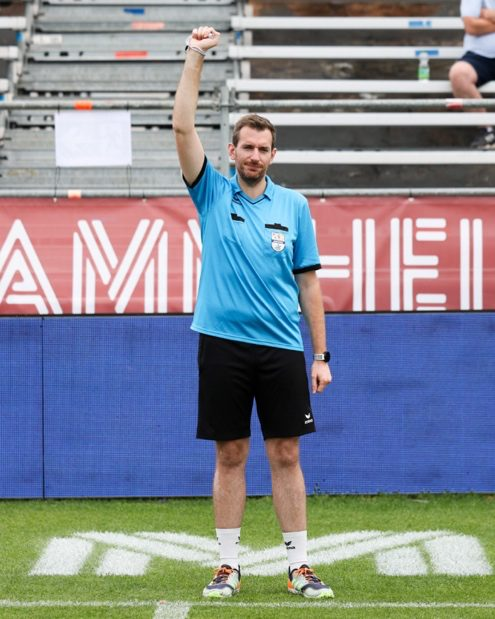

*Foto: `signals/sig-07.jpg`*

**Welches Handzeichen zeigt die Schiedsrichterin bzw. der Schiedsrichter?**  
*Which hand signal is the referee showing?*

- [x] **Block**  —  *Block*
- [ ] Gleichstand  —  *Tie*
- [ ] Ball war knapp gut  —  *Ball was just in*
- [ ] Wiederholung der letzten Angabe  —  *Repetition of the last service*

*Fundstelle:* IFA-Schulungsmappe, Handzeichen 7 – gestreckter Arm, geschlossene Faust senkrecht nach oben, unterstützt durch den Ausruf „BLOCK“.

> Der rechte oder linke gestreckte Arm wird mit geschlossener Faust senkrecht nach oben gehalten. Gleichzeitig wird die Geste mit dem Ausruf „BLOCK“ unterstützt. Das ist NICHT das Zeichen für Gleichstand.

### IFA-BILD-008

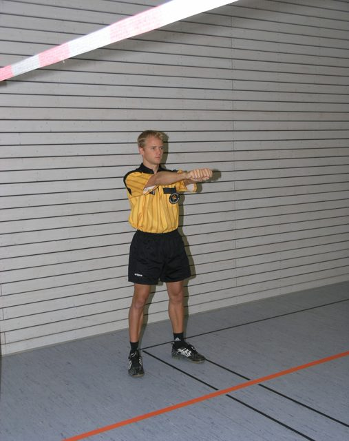

*Foto: `signals/sig-18.jpg`*

**Welches Handzeichen wird hier gezeigt?**  
*Which signal is shown here?*

- [x] **Gleichstand**  —  *Tie*
- [ ] Block  —  *Block*
- [ ] Behinderung  —  *Obstruction*
- [ ] Time out  —  *Time out*

*Fundstelle:* IFA-Schulungsmappe, Handzeichen 18 – beide gestreckten Arme mit geschlossener Faust vor der Brust. Nicht zu verwechseln mit dem Block, bei dem nur ein Arm nach oben geht.

> Der rechte und der linke gestreckte Arm werden mit geschlossener Faust vor der Brust gehalten.

### IFA-BILD-009

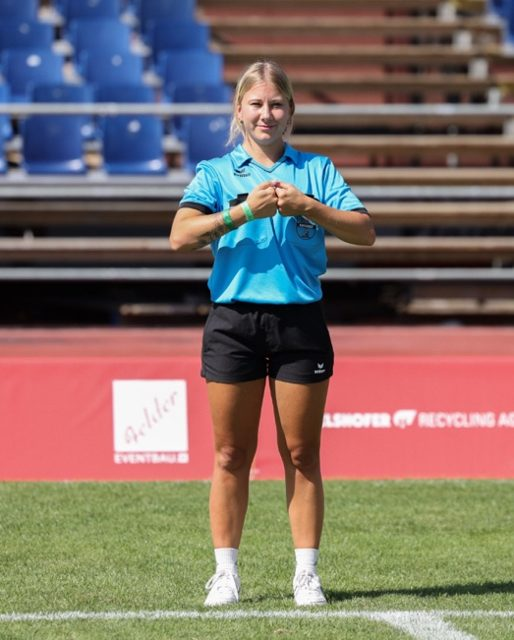

*Foto: `signals/sig-14.jpg`*

**Die Fäuste sind vor der Brust verbunden, die Arme bleiben angewinkelt. Was zeigt die Schiedsrichterin an?**  
*The fists are joined in front of the chest with the arms bent. What is the referee indicating?*

- [x] **Behinderung**  —  *Obstruction*
- [ ] Gleichstand  —  *Tie*
- [ ] Block  —  *Block*
- [ ] Zweimal auf  —  *Two bounces*

*Fundstelle:* IFA-Schulungsmappe, Handzeichen 14 – beide Hände außerhalb des Körperrahmens zu Fäusten geschlossen und horizontal an der Brust verbunden. Beim Gleichstand sind die Arme dagegen nach vorn gestreckt.

> Wenn ein Spieler einen anderen Spieler behindert oder wenn ein Zuschauer einen Spieler behindert, macht der Schiedsrichter beide Hände außerhalb des Körperrahmens zu Fäusten und verbindet sie horizontal an der Brust, um einen Zusammenstoß anzuzeigen.

### IFA-BILD-010

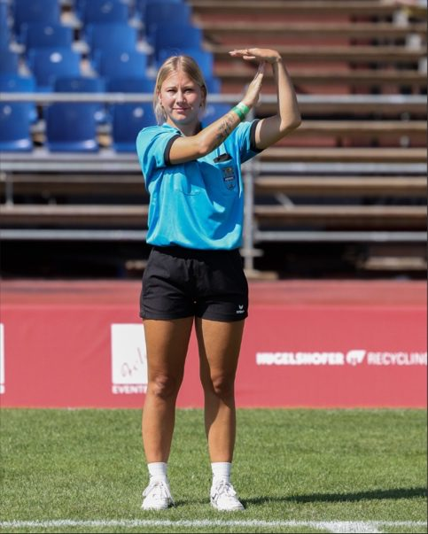

*Foto: `signals/sig-06.jpg`*

**Welches Handzeichen zeigt die Schiedsrichterin?**  
*Which signal is the referee showing?*

- [x] **Time out oder sonstige Spielunterbrechung**  —  *Time out or other interruption of play*
- [ ] Auswechslung  —  *Substitution*
- [ ] Ball hat die Decke berührt  —  *Ball touched the ceiling*
- [ ] Behinderung  —  *Obstruction*

*Fundstelle:* IFA-Schulungsmappe, Handzeichen 6 – ein abgewinkelter Arm zeigt mit geöffneter Hand nach oben, die andere geöffnete Hand wird mittig darüber gelegt.

> Ein abgewinkelter Arm zeigt mit geöffneter Hand nach oben, die andere geöffnete Hand wird mittig über die senkrechte Hand gelegt (Time out).

### IFA-BILD-011

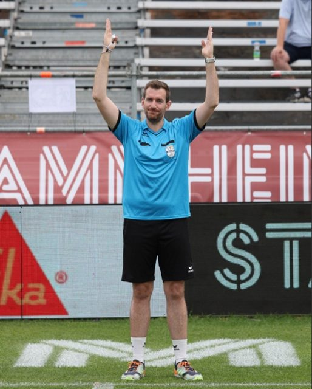

*Foto: `signals/sig-13.jpg`*

**Beide Hände weisen mit geöffneter Handfläche nach oben. Was zeigt der Schiedsrichter an?**  
*Both hands point upwards with open palms. What is the referee indicating?*

- [x] **Der Ball hat nach einem Überschlag die Decke berührt**  —  *After a rebound the ball touched the ceiling*
- [ ] Time out  —  *Time out*
- [ ] Der Ball ist unter dem Band hindurchgeflogen  —  *The ball passed underneath the tape*
- [ ] Gleichstand  —  *Tie*

*Fundstelle:* IFA-Schulungsmappe, Handzeichen 13 – Deckenberührung nach einem Überschlag. Der zweite Arm zeigt danach waagerecht zur Mannschaft, die den Punkt erhält.

> Berührt der Ball nach einem Überschlag die Decke, so weisen beide Hände mit geöffneter Handfläche nach oben. Der zweite Arm zeigt danach in die Waagerechte in die Richtung der Mannschaft, welcher der Punkt gutgeschrieben wird.

### IFA-BILD-012

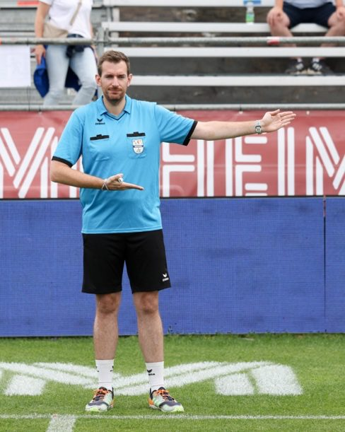

*Foto: `signals/sig-11.jpg`*

**Die offene Hand zeigt mit der Handfläche nach oben schräg nach unten vor dem Körper. Welche Situation wird angezeigt?**  
*The open hand points diagonally downwards in front of the body with the palm facing up. Which situation is being indicated?*

- [x] **Der Ball ist unter dem Band hindurchgeflogen**  —  *The ball passed underneath the tape*
- [ ] Der Ball ist ohne Berührung über das Netz gesprungen  —  *The ball bounced over the net without contact*
- [ ] Der Ball hat den Körper berührt  —  *The ball touched the body*
- [ ] Zweimal auf  —  *Two bounces*

*Fundstelle:* IFA-Schulungsmappe, Handzeichen 11 – die Flugbahn des Balles wird unterhalb des Bandes nachgezeigt.

> Fliegt ein Ball unter dem Band hindurch, so ist mit offener Hand, Handfläche nach oben, Arm vor dem Körper schräg nach unten gerichtet, die Flugbahn des Balles nachzuzeigen.

### IFA-BILD-013

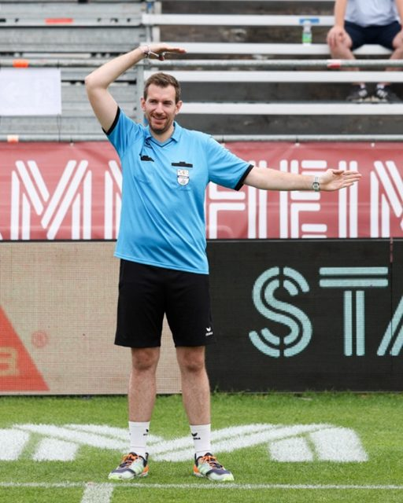

*Foto: `signals/sig-12.jpg`*

**Der Arm führt mit der Handfläche nach unten über den Körper. Welche Situation wird angezeigt?**  
*The arm moves across above the body with the palm facing down. Which situation is being indicated?*

- [x] **Der Ball ist ohne Berührung über das Netz gesprungen**  —  *The ball bounced over the net without contact*
- [ ] Der Ball ist unter dem Band hindurchgeflogen  —  *The ball passed underneath the tape*
- [ ] Der Ball hat die Decke berührt  —  *The ball touched the ceiling*
- [ ] Block  —  *Block*

*Fundstelle:* IFA-Schulungsmappe, Handzeichen 12 – die Flugbahn wird oberhalb des Körpers nachgezeigt, Handfläche nach unten.

> Springt ein Ball ohne Berührung über das Netz, so ist mit offener Hand, Handfläche nach unten, Arm über dem Körper, die Flugbahn des Balles nachzuzeigen.

### IFA-BILD-014

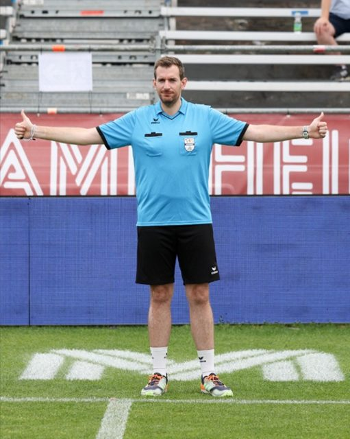

*Foto: `signals/sig-08.jpg`*

**Beide Arme zeigen waagerecht nach außen, die Daumen nach oben. Was bedeutet das Zeichen?**  
*Both arms point horizontally outwards with the thumbs up. What does this signal mean?*

- [x] **Wiederholung der letzten Angabe**  —  *Repetition of the last service*
- [ ] Gleichstand  —  *Tie*
- [ ] Ausball  —  *Ball out*
- [ ] Time out  —  *Time out*

*Fundstelle:* IFA-Schulungsmappe, Handzeichen 8.

> Beide Arme zeigen waagerecht nach außen, die Daumen zeigen nach oben.

### IFA-BILD-015

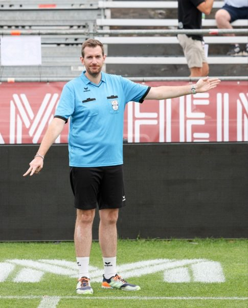

*Foto: `signals/sig-05.jpg`*

**Der gestreckte Arm zeigt mit zwei gespreizten Fingern nach unten. Welcher Fehler wird angezeigt?**  
*The extended arm points downwards with two fingers spread. Which fault is being indicated?*

- [x] **Zweimal auf**  —  *Two bounces*
- [ ] Übertritt  —  *Foot fault*
- [ ] Ball war knapp gut  —  *Ball was just in*
- [ ] Der Ball hat den Körper berührt  —  *The ball touched the body*

*Fundstelle:* IFA-Schulungsmappe, Handzeichen 5.

> Der gestreckte Arm zeigt mit zwei gespreizten Fingern nach unten.

### IFA-BILD-016

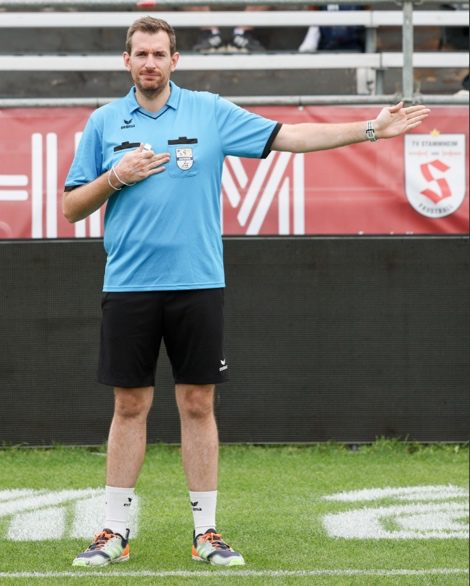

*Foto: `signals/sig-02.jpg`*

**Eine Hand klopft auf einen Körperteil, der zweite Arm zeigt in die Waagerechte. Was zeigt der Schiedsrichter an?**  
*One hand taps a part of the body while the second arm points horizontally. What is the referee indicating?*

- [x] **Der Ball hat diesen Körperteil berührt**  —  *The ball touched this part of the body*
- [ ] Der Spieler ist verletzt und wird ausgewechselt  —  *The player is injured and will be substituted*
- [ ] Behinderung durch einen Gegenspieler  —  *Obstruction by an opponent*
- [ ] Unsportliches Verhalten  —  *Unsporting behaviour*

*Fundstelle:* IFA-Schulungsmappe, Handzeichen 2 – die Hand zeigt auf den Körperteil, den der Ball berührt hat.

> Eine Hand zeigt/klopft auf den Körperteil, den der Ball berührt hat. Der zweite Arm zeigt in die Waagerechte in die Richtung der Mannschaft, die einen Gutpunkt erzielt hat.

### IFA-BILD-017

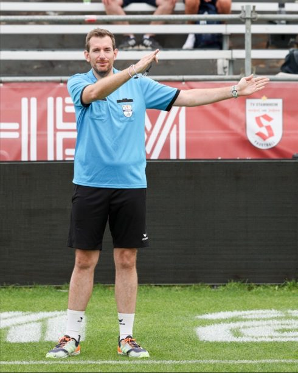

*Foto: `signals/sig-03.jpg`*

**Der ausgestreckte Arm zeigt mit geöffneter Hand nach oben, der zweite Arm in die Waagerechte. Welchen Fehler zeigt der Schiedsrichter an?**  
*The extended arm points upwards with an open hand, the second arm horizontally. Which fault is the referee indicating?*

- [x] **Ball an Netz, Band oder Leine**  —  *Ball at the net, tape or cord*
- [ ] Übertritt an der Angabelinie  —  *Foot fault at the service line*
- [ ] Ball ohne Berührung über das Netz  —  *Ball over the net without contact*
- [ ] Zweimal auf  —  *Two bounces*

*Fundstelle:* IFA-Schulungsmappe, Handzeichen 3 – ein ausgestreckter Arm mit geöffneter Hand zeigt in Richtung Netz (Band/Leine). Beim Übertritt (Zeichen 4) weist derselbe Arm dagegen schräg nach unten zur Angabelinie.

> Ein ausgestreckter Arm mit geöffneter Hand zeigt in Richtung Netz (Band/Leine). Der zweite Arm zeigt in die Waagerechte in die Richtung der Mannschaft, die einen Gutpunkt erzielt hat.

### IFA-BILD-018

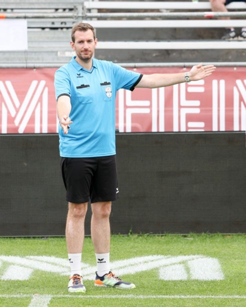

*Foto: `signals/sig-04.jpg`*

**Der ausgestreckte Arm zeigt mit geöffneter Hand schräg nach unten, der zweite Arm in die Waagerechte. Welchen Fehler zeigt der Schiedsrichter an?**  
*The extended arm points diagonally downwards with an open hand, the second arm horizontally. Which fault is the referee indicating?*

- [x] **Übertritt an der Angabelinie**  —  *Foot fault at the service line*
- [ ] Ball an Netz, Band oder Leine  —  *Ball at the net, tape or cord*
- [ ] Ball unter dem Band hindurch  —  *Ball underneath the tape*
- [ ] Behinderung  —  *Obstruction*

*Fundstelle:* IFA-Schulungsmappe, Handzeichen 4 – ein ausgestreckter Arm mit geöffneter Hand zeigt in Richtung Angabelinie. Beim Netzfehler (Zeichen 3) weist derselbe Arm nach oben.

> Ein ausgestreckter Arm mit geöffneter Hand zeigt in Richtung Angabelinie. Der zweite Arm zeigt in die Waagerechte in die Richtung der Mannschaft, die einen Gutpunkt erzielt hat.

### IFA-BILD-019

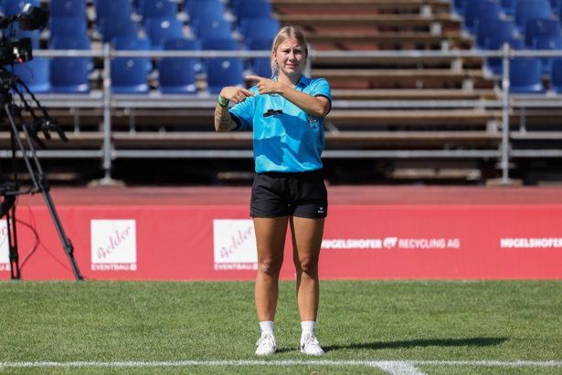

*Foto: `signals/sig-09.jpg`*

**Beide Hände kreisen umeinander. Was zeigt die Schiedsrichterin an?**  
*Both hands circle around each other. What is the referee indicating?*

- [x] **Auswechslung**  —  *Substitution*
- [ ] Time out  —  *Time out*
- [ ] Wiederholung der letzten Angabe  —  *Repetition of the last service*
- [ ] Zweimal auf  —  *Two bounces*

*Fundstelle:* IFA-Schulungsmappe, Handzeichen 9 – die Auswechslung ist durch Kreisen beider Hände über dem Kopf zu signalisieren. Das Foto zeigt die Bewegung auf Brusthöhe; maßgeblich ist die Beschreibung.

> Die Auswechslung ist durch Kreisen beider Hände über dem Kopf zu signalisieren.

### IFA-C-027

**Wohin zeigt bei den meisten Handzeichen der zweite Arm?**  
*With most hand signals, where does the second arm point?*

- [x] **In die Waagerechte, in Richtung der Mannschaft, die den Gutball erzielt hat**  —  *Horizontally, towards the team that has won the point*
- [ ] In die Waagerechte, in Richtung der Mannschaft, die den Fehler begangen hat  —  *Horizontally, towards the team that committed the fault*
- [ ] Immer in Richtung des Anschreibertisches  —  *Always towards the scorer's table*
- [ ] Senkrecht nach oben, um die Unterbrechung zu bestätigen  —  *Vertically upwards, to confirm the interruption*

*Fundstelle:* IFA-Schulungsmappe, Handzeichen 1 bis 5 und 11 bis 14 – der zweite Arm weist stets der Mannschaft mit dem Gutpunkt zu.

> Der zweite Arm zeigt in die Waagerechte in die Richtung der Mannschaft, die einen Gutpunkt erzielt hat.

### IFA-A-044

**Der Ball berührt den Fuß eines Spielers. Wie zeigt der Schiedsrichter das an?**  
*The ball touches a player's foot. How does the referee indicate this?*

- [x] **Die Hand auf Brust oder Oberschenkel genügt, bei Bedarf ergänzt durch den Zuruf „Fuß“**  —  *Touching the chest or thigh is sufficient, if necessary supported by calling ‚foot‘*
- [ ] Der Schiedsrichter muss sich bücken und den Fuß berühren  —  *The referee has to bend down and touch the foot*
- [ ] Es gibt kein Handzeichen, der Pfiff allein genügt  —  *There is no hand signal, the whistle alone is sufficient*
- [ ] Der Schiedsrichter zeigt mit gespreizten Fingern nach unten  —  *The referee points downwards with spread fingers*

*Fundstelle:* IFA-Schulungsmappe, Handzeichen 2, Hinweis zu Treffern am Fuß.

> Bei Treffern am Fuß reicht die Hand auf Brust oder Oberschenkel, ggf. mit verbaler Ergänzung „Fuß“.

## Kapitel 12 — Aufgaben und Verhalten des Schiedsrichters (7 Fragen)

### IFA-C-028

**Worauf gründet der Schiedsrichter seine Entscheidungen?**  
*On what does the referee base his decisions?*

- [x] **Auf die visuelle Wahrnehmung; das Gehör darf sie nur bestätigen**  —  *On visual perception; hearing may only confirm it*
- [ ] Auf das Gehör, weil ein Ballkontakt hörbar ist  —  *On hearing, because contact with the ball is audible*
- [ ] Auf die übereinstimmende Einschätzung beider Mannschaftsführer  —  *On the matching assessment of both team captains*
- [ ] Auf die Einschätzung der Linienrichter  —  *On the assessment of the linesmen*

*Fundstelle:* IFA-Schulungsmappe, Verhalten des Schiedsrichters – neutrale Entscheidungsfindung.

> Der Schiedsrichter trifft seine Entscheidungen auf Grund visueller Wahrnehmung und lässt sich durch Spieler, Betreuungspersonen oder Zuschauer nicht beeinflussen. Das Gehör darf ihm die Richtigkeit seiner optischen Wahrnehmung nur bestätigen.

### IFA-A-045

**Der Schiedsrichter erkennt unmittelbar, dass seine Entscheidung falsch war. Wie ist zu verfahren?**  
*The referee immediately realises that his decision was wrong. How should he proceed?*

- [x] **Er kann sie ohne weiteres zurücknehmen, sofern der Spielgang das noch zulässt**  —  *He may withdraw it without further ado, provided the rally still allows it*
- [ ] Eine getroffene Entscheidung ist in keinem Fall zurückzunehmen  —  *A decision once taken must never be withdrawn*
- [ ] Er nimmt sie nur zurück, wenn beide Mannschaftsführer zustimmen  —  *He only withdraws it if both team captains agree*
- [ ] Er gleicht den Fehler bei der nächsten strittigen Situation aus  —  *He compensates for the error at the next disputed situation*

*Fundstelle:* IFA-Schulungsmappe, Verhalten des Schiedsrichters – Umgang mit eigenen Fehlern.

> Stelle ich fest, dass ich eine falsche Entscheidung getroffen habe, so kann ich diese ohne weiteres zurücknehmen, wenn es der Spielgang zulässt.

### IFA-A-046

**Eine Mannschaft legt Einspruch gegen eine Tatsachenentscheidung ein. Was tut der Schiedsrichter?**  
*A team lodges an objection against a decision of fact. What does the referee do?*

- [x] **Er vermerkt den Einspruch sofort auf dem Spielformular**  —  *He notes the objection on the match form immediately*
- [ ] Er weist ihn zurück, da Tatsachenentscheidungen unanfechtbar sind, und vermerkt nichts  —  *He rejects it, since decisions of fact are final, and records nothing*
- [ ] Er unterbricht das Spiel bis zur Klärung durch die Spielleitung  —  *He interrupts the match until the competition management has clarified it*
- [ ] Er trägt ihn nur ein, wenn er den Einspruch für berechtigt hält  —  *He records it only if he considers the objection justified*

*Fundstelle:* IFA-Schulungsmappe, Verhalten des Schiedsrichters – Einsprüche. Auch Einsprüche gegen Tatsachenentscheidungen sind sofort zu vermerken.

> Einsprüche – auch solche gegen Tatsachenentscheidungen – sind auf dem Spielformular sofort zu vermerken.

### IFA-C-029

**Der Mannschaftsführer stellt während des Spiels eine Frage. Wie verhält sich der Schiedsrichter?**  
*The team captain asks a question during the match. How does the referee respond?*

- [x] **Er muss antworten, gibt die Antwort kurz und klar und lässt keine Diskussion zu**  —  *He must answer, gives the answer briefly and clearly and allows no discussion*
- [ ] Er ist zu einer Antwort nicht verpflichtet  —  *He is not obliged to answer*
- [ ] Er antwortet erst in der nächsten Spielpause  —  *He answers only at the next break in play*
- [ ] Er verweist die Frage an den Anschreiber  —  *He refers the question to the scorer*

*Fundstelle:* IFA-Schulungsmappe, Verhalten des Schiedsrichters – Fragen von Mannschaftsführern.

> Auf Fragen des Mannschaftsführers muss der Schiedsrichter antworten. Er gibt die Antwort kurz und klar und lässt keine Diskussion zu.

### IFA-A-047

**Wer darf bei einer Jugendmannschaft an Stelle des Mannschaftsführers Fragen an den Schiedsrichter richten?**  
*In a youth team, who may address questions to the referee instead of the team captain?*

- [x] **Gegebenenfalls eine volljährige Betreuungsperson**  —  *If applicable, an adult member of the support staff*
- [ ] Jeder Spieler der Mannschaft  —  *Any player of the team*
- [ ] Ausschließlich der Mannschaftsführer, ohne Ausnahme  —  *Exclusively the team captain, without exception*
- [ ] Ein Elternteil aus dem Zuschauerbereich  —  *A parent from the spectator area*

*Fundstelle:* IFA-Schulungsmappe, Verhalten des Schiedsrichters – Fragen von Mannschaftsführern.

> Auf Fragen des Mannschaftsführers – bei Jugendmannschaften ggf. einer volljährigen Betreuungsperson – muss der Schiedsrichter antworten.

### IFA-A-048

**Das Spiel artet aus und der Schiedsrichter fühlt sich durch Zuschauer bedroht. Was hat er zu tun?**  
*The match gets out of hand and the referee feels threatened by spectators. What must he do?*

- [x] **Er erteilt den Mannschaftsführern beziehungsweise dem Veranstalter die notwendigen Weisungen**  —  *He gives the necessary instructions to the team captains or to the organiser*
- [ ] Er bricht das Spiel unverzüglich und endgültig ab  —  *He abandons the match immediately and definitively*
- [ ] Er setzt das Spiel unverändert fort, da Zuschauer nicht seine Zuständigkeit sind  —  *He continues the match unchanged, as spectators are not his responsibility*
- [ ] Er übergibt die Spielleitung an einen Linienrichter  —  *He hands over the conduct of the match to a linesman*

*Fundstelle:* IFA-Schulungsmappe, Verhalten des Schiedsrichters – der Schiedsrichter hat alle Maßnahmen zu ergreifen, die eine klaglose Beendigung des Wettspieles ermöglichen.

> Artet das Spiel aus oder fühlt sich der Schiedsrichter durch Zuschauer bedroht, so hat er den Mannschaftsführern bzw. dem Veranstalter die notwendigen Weisungen zu erteilen.

### IFA-C-030

**Wie hält es der Schiedsrichter mit den Eintragungen des Anschreibers?**  
*How does the referee handle the scorer's entries?*

- [x] **Er überwacht sie und prüft die Aufzeichnung in regelmäßigen Abständen**  —  *He supervises them and checks the record at regular intervals*
- [ ] Er prüft sie ausschließlich nach Spielende  —  *He checks them only after the end of the match*
- [ ] Die Prüfung obliegt allein den Mannschaftsführern  —  *Checking is solely the responsibility of the team captains*
- [ ] Er prüft sie nur, wenn eine Mannschaft das verlangt  —  *He checks them only if a team requests it*

*Fundstelle:* IFA-Schulungsmappe, Aufgaben des Schiedsrichters während des Spiels.

> Der Schiedsrichter überwacht die Aufzeichnungen im Spielformular. In regelmäßigen Abständen ist die Aufzeichnung des Anschreibers zu prüfen.

## Kapitel 13 — Linienrichter und Anschreiber (9 Fragen)

### IFA-C-031

**Wo haben die Linienrichter ihren Stand?**  
*Where are the linesmen positioned?*

- [x] **An den Endpunkten der dem Schiedsrichter gegenüberliegenden Seitenlinie**  —  *At the end points of the side line opposite the referee*
- [ ] An den Endpunkten der Seitenlinie auf der Seite des Schiedsrichters  —  *At the end points of the side line on the referee's side*
- [ ] Jeweils hinter den beiden Grundlinien  —  *Behind the two base lines*
- [ ] Neben dem Anschreibertisch  —  *Next to the scorer's table*

*Fundstelle:* Spielregeln 9.3.

> Die Linienrichter haben ihren Stand an den Endpunkten der dem Schiedsrichter gegenüberliegenden Seitenlinie. (Regel 9.3)

### IFA-C-032

**Der Linienrichter zeigt mit der Fahne senkrecht nach oben. Was bedeutet das?**  
*The linesman holds the flag vertically upwards. What does that mean?*

- [x] **Der Ball hat die Außenlinie überschritten**  —  *The ball has crossed the outer line*
- [ ] Der Ball hat die Außenlinie nicht überschritten  —  *The ball has not crossed the outer line*
- [ ] Der Linienrichter kann die Situation nicht beurteilen  —  *The linesman cannot judge the situation*
- [ ] Der Linienrichter bittet um eine Spielunterbrechung  —  *The linesman requests an interruption of play*

*Fundstelle:* IFA-Schulungsmappe, Handzeichen 16 – Linienrichter und Schiedsrichter-Assistenten.

> Hat der Ball die Außenlinie überschritten, zeigt der Linienrichter mit der Fahne nach oben. Hat er sie nicht überschritten, zeigt die Fahne in Richtung Spielfeld.

### IFA-C-033

**Der Linienrichter hält die Fahne mit beiden Händen waagerecht in Brusthöhe. Was heißt das?**  
*The linesman holds the flag horizontally at chest height with both hands. What does that mean?*

- [x] **Er kann zu der Situation keine Aussage machen**  —  *He cannot give a judgement on the situation*
- [ ] Der Ball war eindeutig im Feld  —  *The ball was clearly inside the court*
- [ ] Der Ball war eindeutig im Aus  —  *The ball was clearly out*
- [ ] Er meldet einen Wechsel der Linienrichter an  —  *He is announcing a change of linesmen*

*Fundstelle:* IFA-Schulungsmappe, Handzeichen 16 sowie die beste Position des Linienschiedsrichters 3.

> Kann der Linienrichter keine Aussage machen, hält er die Fahne mit beiden Händen waagerecht in Brusthöhe.

### IFA-A-049

**Beide Linienrichter können einen Ausball nicht beurteilen. Wer entscheidet?**  
*Neither linesman can judge a ball out. Who decides?*

- [x] **Der Schiedsrichter übernimmt die Verantwortung und entscheidet**  —  *The referee takes responsibility and decides*
- [ ] Der Ballwechsel wird wiederholt  —  *The rally is replayed*
- [ ] Der Punkt geht an die abwehrende Mannschaft  —  *The point goes to the defending team*
- [ ] Die Mannschaftsführer einigen sich  —  *The team captains reach an agreement*

*Fundstelle:* IFA-Schulungsmappe, die beste Position des Linienschiedsrichters 3 – kann auch der Kollege die Situation nicht erkennen, übernimmt der Schiedsrichter.

> Kann ein Linienrichter die Situation „Ausball“ nicht erkennen, … so ist die Fahne waagerecht vor den Körper zu halten. In diesem Falle übernimmt der Kollege die Verantwortung. Kann auch dieser die Situation nicht erkennen, übernimmt der Schiedsrichter.

### IFA-A-050

**Ein Ball geht ins Aus. Wie ist das Zusammenspiel der beiden Linienrichter geregelt?**  
*A ball goes out. How is the interaction between the two linesmen regulated?*

- [x] **Der vorrangige Linienrichter hebt die Fahne, der Kollege quittiert mit kurzer Verzögerung**  —  *The linesman in charge raises the flag, the colleague acknowledges with a short delay*
- [ ] Beide heben die Fahne gleichzeitig, damit die Entscheidung eindeutig ist  —  *Both raise the flag simultaneously so that the decision is unambiguous*
- [ ] Nur der Linienrichter auf der Angabeseite zeigt an, der andere bleibt untätig  —  *Only the linesman on the service side signals, the other remains inactive*
- [ ] Der Kollege reagiert zuerst, damit der vorrangige Linienrichter ihn bestätigen kann  —  *The colleague reacts first so that the linesman in charge can confirm him*

*Fundstelle:* IFA-Schulungsmappe, die beste Position des Linienschiedsrichters 2 – der Kollege darf auf keinen Fall zuerst reagieren.

> Bei Ausbällen wird die Fahne von dem „vorrangigen Linienrichter“ senkrecht nach oben gestreckt. Der Kollege quittiert dies mit kurzer Verzögerung. Auf keinen Fall darf er zuerst reagieren.

### IFA-A-051

**Halle: Der Ball springt im Feld auf und berührt danach die Hallenwand. Wie signalisiert der Linienrichter?**  
*Indoor: the ball bounces inside the court and then touches the hall wall. How does the linesman signal?*

- [x] **Fahne in das Feld, gleichzeitig den anderen Arm senkrecht nach oben**  —  *Flag into the court and at the same time the other arm vertically upwards*
- [ ] Nur die Fahne senkrecht nach oben  —  *Only the flag vertically upwards*
- [ ] Nur die Fahne in Richtung Spielfeld  —  *Only the flag towards the court*
- [ ] Fahne waagerecht vor dem Körper  —  *Flag horizontally in front of the body*

*Fundstelle:* IFA-Schulungsmappe, Besonderheiten in der Halle. Dieselbe Signalisierung gilt, wenn der Ball ins Aus fliegt und die abwehrende Mannschaft ihn berührt hat.

> Wenn ein Ball im Feld aufspringt und dann die Hallenwand berührt, so weist der Linienrichter mit der Fahne in das Feld und hebt den anderen Arm senkrecht nach oben.

### IFA-C-034

**Wann wechselt der Standpunkt der Linienrichter?**  
*When do the linesmen change their position?*

- [x] **Mit jedem Ballwechsel, also beim Angriffs- oder Angabewechsel**  —  *With every rally, that is at each change of attack or service*
- [ ] Nur beim Seitenwechsel zur Halbzeit  —  *Only when changing ends at half time*
- [ ] Nach jedem gewonnenen Satz  —  *After each set won*
- [ ] Der Standpunkt bleibt während des gesamten Spiels unverändert  —  *The position remains unchanged throughout the match*

*Fundstelle:* IFA-Schulungsmappe, der Standort der Linienrichter.

> Der Standpunkt an den gegenüberliegenden Seitenlinien wechselt mit jedem Ballwechsel. … Beim Angriffs- oder Angabewechsel wechseln die beiden Positionen.

### IFA-A-052

**Dürfen Linienrichter während eines Spiels ausgewechselt werden?**  
*May linesmen be replaced during a match?*

- [x] **Nur aufgrund besonderer Umstände, etwa bei Übelkeit**  —  *Only for special reasons, for instance if they feel unwell*
- [ ] Ja, jederzeit auf Wunsch des Veranstalters  —  *Yes, at any time at the organiser's request*
- [ ] Ja, aber nur in der Halbzeitpause  —  *Yes, but only during the half-time break*
- [ ] Nein, ein Wechsel ist ausnahmslos ausgeschlossen  —  *No, a change is excluded without exception*

*Fundstelle:* IFA-Schulungsmappe, Auswechslung von Linienrichtern.

> Linienrichter dürfen während eines Spieles nur aufgrund besonderer Umstände ausgewechselt werden, etwa bei Übelkeit.

### IFA-C-035

**Welche Aufgabe hat der Anschreiber?**  
*What is the task of the scorer?*

- [x] **Er hat seinen Platz in der Nähe des Schiedsrichters und bucht nach dessen Zeichen die Gutbälle beider Mannschaften**  —  *He is positioned near the referee and records the points of both teams following the referee's signals*
- [ ] Er entscheidet bei strittigen Bällen gemeinsam mit den Linienrichtern  —  *He decides on disputed balls together with the linesmen*
- [ ] Er misst die Spielzeit und pfeift das Spielende an  —  *He measures the playing time and whistles for the end of the match*
- [ ] Er prüft vor dem Spiel die Spielberechtigung der Spieler  —  *He checks the players' eligibility before the match*

*Fundstelle:* Spielregeln 9.4.

> Der Anschreiber hat seinen Platz in der Nähe des Schiedsrichters und bucht nach dessen Zeichen für beide Mannschaften die gewonnenen Gutbälle. (Regel 9.4)

## Kapitel 8 — Wertung (2 Fragen)

### IFA-C-036

**Wie wird ein Fehler gewertet?**  
*How is a fault scored?*

- [x] **Als Gutball für die gegnerische Mannschaft**  —  *As a point for the opposing team*
- [ ] Als Punktabzug für die fehlerhafte Mannschaft  —  *As a point deduction for the team at fault*
- [ ] Der Ballwechsel wird ohne Wertung wiederholt  —  *The rally is replayed without being scored*
- [ ] Die Angabe geht an die gegnerische Mannschaft, ohne dass ein Punkt fällt  —  *The service passes to the opposing team without a point being scored*

*Fundstelle:* Spielregeln 8.1.

> Jeder Fehler wird als Gutball für die gegnerische Mannschaft gewertet. (Regel 8.1)

### IFA-A-053

**Worauf achtet der Schiedsrichter bei der Eintragung der Gutbälle im Spielbericht besonders?**  
*What does the referee pay particular attention to when points are entered in the match report?*

- [x] **Dass der Anschreiber die Leerfelder nicht entwertet**  —  *That the scorer does not invalidate the empty fields*
- [ ] Dass die Gutbälle mit römischen Ziffern eingetragen werden  —  *That the points are entered in Roman numerals*
- [ ] Dass jede Mannschaft ihre eigenen Punkte selbst einträgt  —  *That each team enters its own points itself*
- [ ] Dass nur die Sätze, nicht die einzelnen Gutbälle festgehalten werden  —  *That only the sets and not the individual points are recorded*

*Fundstelle:* IFA-Schulungsmappe, Kontrolle des Anschreibers zu Regel 8.2. Die Gutbälle werden mit arabischen Ziffern in zeitlicher Reihenfolge eingetragen.

> Der Schiedsrichter achtet darauf, dass der Anschreiber die Aufgabenstellung beherrscht. Ein Entwerten der Leerfelder ist zu verhindern.

## Kapitel 16 — Aufgaben rund um das Spiel (6 Fragen)

### IFA-C-037  ·  Verbandsordnung

**Wann soll der Schiedsrichter am Spielort anwesend sein?**  
*When should the referee be present at the venue?*

- [x] **30 Minuten vor Spielbeginn**  —  *30 minutes before the start of the match*
- [ ] 15 Minuten vor Spielbeginn  —  *15 minutes before the start of the match*
- [ ] 60 Minuten vor Spielbeginn  —  *60 minutes before the start of the match*
- [ ] Unmittelbar vor der Auslosung  —  *Immediately before the toss*

*Fundstelle:* Schiedsrichterordnung, Aufgaben vor dem Spiel. Rechtzeitig genug, um Spielformular, Zeitvergleich und Geräteprüfung vor dem planmäßigen Anpfiff zu erledigen.

> Der Schiedsrichter sollte 30 Minuten vor Spielbeginn am Spielort anwesend sein.

### IFA-C-038  ·  Verbandsordnung

**Wie ist der zeitliche Ablauf unmittelbar vor Spielbeginn geregelt?**  
*How is the sequence immediately before the start of the match regulated?*

- [x] **5 Minuten vorher beendet ein anhaltender Pfiff das Einspielen, 3 Minuten vorher wird ausgelost**  —  *5 minutes before, a sustained whistle ends the warm-up; 3 minutes before, the toss takes place*
- [ ] 3 Minuten vorher endet das Einspielen, 1 Minute vorher wird ausgelost  —  *3 minutes before, the warm-up ends; 1 minute before, the toss takes place*
- [ ] 10 Minuten vorher endet das Einspielen, 5 Minuten vorher wird ausgelost  —  *10 minutes before, the warm-up ends; 5 minutes before, the toss takes place*
- [ ] Auslosung und Ende des Einspielens fallen zusammen  —  *The toss and the end of the warm-up coincide*

*Fundstelle:* Schiedsrichterordnung, Aufgaben vor dem Spiel – Auslosung.

> Etwa 5 Minuten vor Spielbeginn fordert ein anhaltender Pfiff die Mannschaften auf, das Einspielen einzustellen, sodass 3 Minuten vor Spielbeginn ausgelost werden kann.

### IFA-C-039

**Worüber wird vor Spielbeginn mit den Mannschaftsführern ausgelost?**  
*What is decided by the toss with the team captains before the match?*

- [x] **Feld oder Ball und damit die erste Angabe**  —  *Choice of end or ball, and thereby the first service*
- [ ] Nur die Spielfeldseite; die Angabe hat immer die Heimmannschaft  —  *Only the end; the home team always serves first*
- [ ] Nur die erste Angabe; die Seiten sind vorgegeben  —  *Only the first service; the ends are predetermined*
- [ ] Die Reihenfolge der Auswechslungen  —  *The order of substitutions*

*Fundstelle:* Schiedsrichterordnung, Aufgaben vor dem Spiel – Auslosung.

> Er lost mit den Mannschaftsführern Feld oder Ball und damit die erste Angabe aus.

### IFA-A-054

**Wo verwahrt der Schiedsrichter die nicht gespielten Bälle?**  
*Where does the referee keep the balls that are not in play?*

- [x] **Außerhalb des Auslaufs – im Auslauf darf außer dem gespielten Ball kein weiterer Ball liegen**  —  *Outside the run-off area – apart from the ball in play, no ball may lie in the run-off area*
- [ ] Direkt neben dem Pfosten, damit der nächste Ball schnell greifbar ist  —  *Directly beside the post, so that the next ball is quickly at hand*
- [ ] Verteilt im Auslauf hinter den Grundlinien, damit sie schnell greifbar sind  —  *Spread around the run-off area behind the base lines so they are quickly at hand*
- [ ] Die Bälle verbleiben bei den Mannschaften auf der Auswechselbank  —  *The balls stay with the teams on the substitutes' bench*

*Fundstelle:* Schiedsrichterordnung, Aufgaben während des Spiels – Verwahrung der Bälle. Außer dem gespielten Ball gehört kein Ball in den Auslauf: Spieler verfolgen den Ball dort mit dem Blick nach oben und können auf einem liegenden Ball umknicken. Die Reservebälle liegen mindestens 3 bis 5 m hinter dem Pfosten, außerhalb des Auslaufs.

> Der nächste Ball, der ins Spiel gebracht werden könnte, liegt direkt neben dem Pfosten, alle weiteren 3 bis 5 m hinter dem Pfosten.
>
> *Korrigiert am 6. August 2026 nach Hinweis von Toby: Außer dem gespielten Ball darf kein Ball im Auslauf liegen — auch nicht der nächste einsetzbare. Alle Reservebälle gehören außerhalb des Auslaufs. Verletzungsgefahr. Die Formulierung des Foliensatzes („direkt neben dem Pfosten“) ist damit überholt; Frage und Kapiteltext folgen der korrigierten Fassung.*

### IFA-A-055

**Wie werden die zu Beginn tatsächlich eingesetzten Spieler im Spielformular kenntlich gemacht?**  
*How are the players actually fielded at the start marked on the match form?*

- [x] **Mit einem Kreuz; nicht anwesende Spieler werden gestrichen**  —  *With a cross; players who are absent are struck out*
- [ ] Durch Unterstreichen des Namens; nicht anwesende Spieler bleiben stehen  —  *By underlining the name; absent players are left in the list*
- [ ] Durch die Rückennummer in Klammern  —  *By the shirt number in brackets*
- [ ] Es wird nichts markiert, der Eintrag der Namen genügt  —  *Nothing is marked, entering the names is sufficient*

*Fundstelle:* Schiedsrichterordnung, Aufgaben vor dem Spiel – Formulareintragungen. Ergänzungen und Auswechslungen werden nachgetragen.

> Die zu Beginn tatsächlich eingesetzten Spieler werden mit einem Kreuz markiert. Ergänzungen und Auswechslungen werden nachgetragen, nicht anwesende Spieler gestrichen.

### IFA-A-056

**Was hat der Schiedsrichter nach dem Spiel mit dem Spielformular zu tun?**  
*What must the referee do with the match form after the match?*

- [x] **Er prüft es auf Vollständigkeit, schließt es mit seiner Unterschrift ab und übergibt es der Spielleitung**  —  *He checks it for completeness, closes it with his signature and hands it to the competition management*
- [ ] Er übergibt es unverzüglich dem Mannschaftsführer der Heimmannschaft  —  *He hands it immediately to the captain of the home team*
- [ ] Er behält es und reicht es innerhalb einer Woche nach  —  *He keeps it and submits it within a week*
- [ ] Er übergibt es dem Anschreiber, der es unterschreibt  —  *He hands it to the scorer, who signs it*

*Fundstelle:* Schiedsrichterordnung, Aufgaben nach dem Spiel – Formularprüfung.

> Er prüft die Vollständigkeit des Spielformulars, schließt mit seiner Unterschrift ab und übergibt es der Spielleitung.
