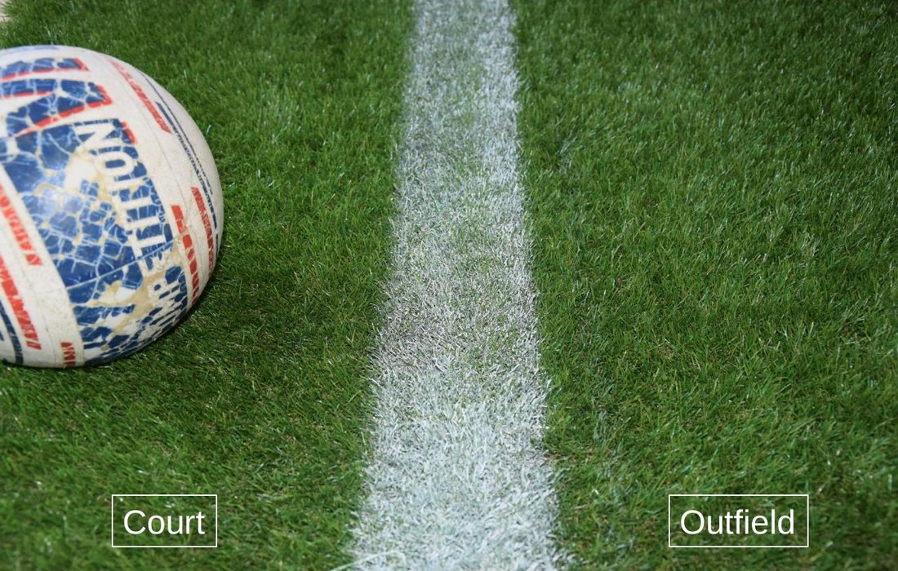
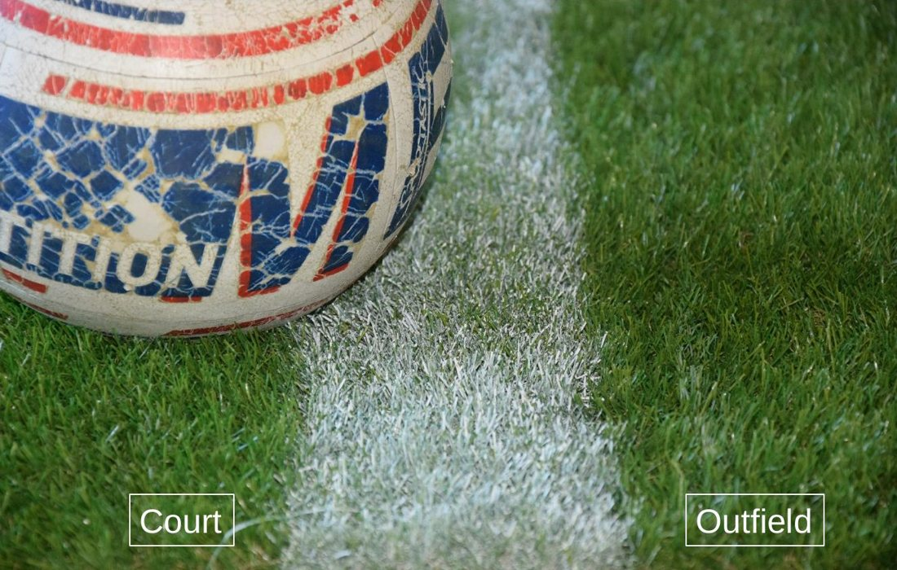
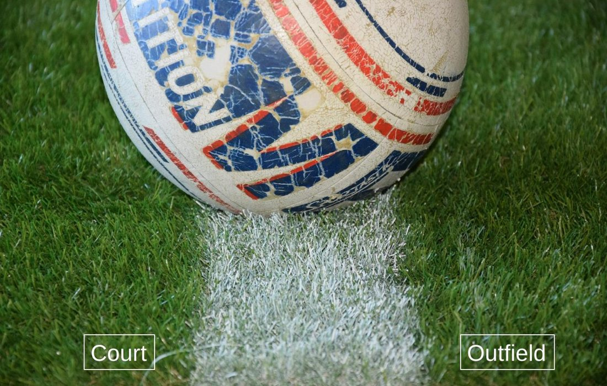
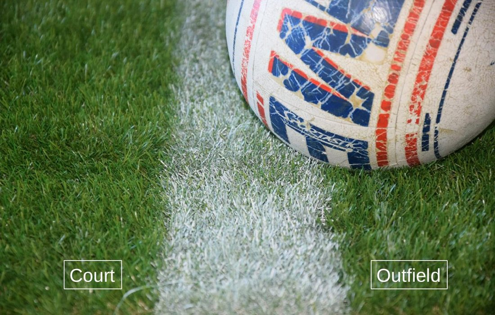
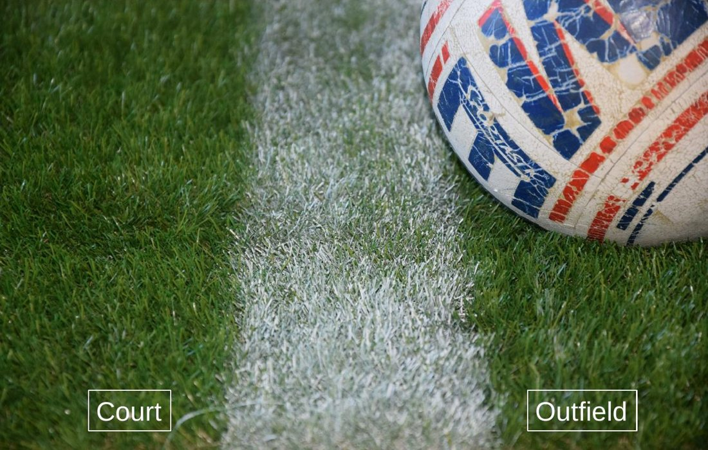
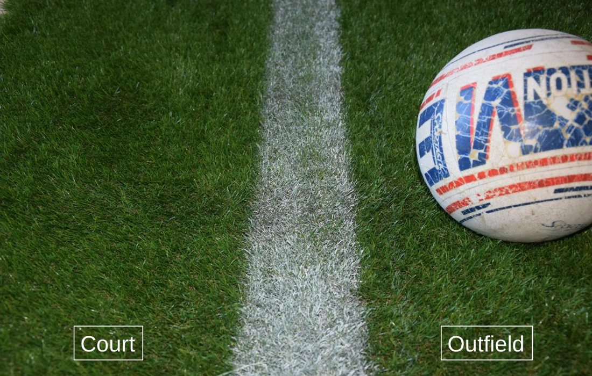

# Ergänzte Fragen – Herkunftsnachweis

**Freigegeben am 6. August 2026.** Dieses Dokument hält fest, auf welche Quellstelle
sich jede der 75 ergänzten Fragen stützt – als Nachweis, warum eine Antwort richtig ist,
und als Grundlage, falls eine Frage später überarbeitet werden soll.

Abgeleitet aus den IFA-Spielregeln 2025, der IFA-Schulungsmappe 2025 und den Schulungsfolien-
sätzen – 32 auf C-Niveau, 43 auf A-Niveau. Sechs davon sind Bildfragen.

Einstufung: **C** für Grundwissen zur Spielleitung, **A** für Auslegung, Ermessen, Sonderfälle
und Strafen.

Die englische Fassung steht jeweils kursiv darunter. Sie ist eine Arbeitsübersetzung und
fachlich noch nicht abgenommen; maßgeblich ist der deutsche Wortlaut.

---

# Stufe C (32 Fragen)

## Kapitel 1 — Spielfeld und Geräte

### IFA-C-001

**Wie wird das Breitenmaß des Spielfeldes von 20 m gemessen?**  
*How is the court width of 20 m measured?*

- [x] **Von Außenkante zu Außenkante der Grenzlinien**  —  *From the outer edge to the outer edge of the boundary lines*
- [ ] Von Innenkante zu Innenkante der Grenzlinien  —  *From the inner edge to the inner edge of the boundary lines*
- [ ] Von Linienmitte zu Linienmitte  —  *From the middle of one line to the middle of the other*
- [ ] Von der Außenkante der einen zur Innenkante der anderen Linie  —  *From the outer edge of one line to the inner edge of the other*

*Fundstelle:* Spielregeln 1.1.2, Erläuterung Lage und Maß der Linien

> Das Maß von der Mittellinie zu den 3m- und hinteren Begrenzungslinien wird von der Mitte der Mittellinie bis hintere Kante 3m- und hintere Begrenzungslinie gemessen. Das Breitenmaß 20m wird von Außenkante- zu Außenkante der Grenzlinien gemessen. Ein Ball, der diese Linien berührt, ist im Feld.

### IFA-C-002

**Ein Ball landet so, dass er die Grenzlinie mit einem Teil seines Umfangs überdeckt, sie aber nicht berührt. Wie entscheidest du?**  
*A ball lands so that part of its circumference covers the boundary line without touching it. What is your decision?*

- [x] **Aus – der Ball muss die Linie berühren**  —  *Out – the ball has to touch the line*
- [ ] Gut – das Überdecken der Linie genügt  —  *In – covering the line is enough*
- [ ] Gut, sofern der Ball mit vollem Umfang über der Linie steht  —  *In, provided the ball stands over the line with its full circumference*
- [ ] Wiederholung der letzten Angabe  —  *Replay of the last service*

*Fundstelle:* Spielregeln 1.1.2, Erläuterung Aus oder In

> „Ein Ball, der diese Linien berührt“ = er muss die Linie berühren, und nicht nur (wie z.B. im Fußball) mit seinem Umfang die Linie überdecken. Den im Fußball oft zitierten „vollen Umfang“ kennt die Faustball-Spielregel nur beim direkten Überqueren der Mittellinie ohne vorherigen Bodenkontakt (Regel 7.2.1).

### IFA-C-003

**Wo wird die Höhe der Leine gemessen?**  
*Where is the height of the net measured?*

- [x] **Vom Boden bis zur Oberkante der Leine**  —  *From the ground to the upper edge of the net*
- [ ] Vom Boden bis zur Unterkante der Leine  —  *From the ground to the lower edge of the net*
- [ ] Vom Boden bis zur Mitte der Leine  —  *From the ground to the middle of the net*
- [ ] Vom Boden bis zur Oberkante des Pfostens  —  *From the ground to the top of the post*

*Fundstelle:* Spielregeln 1.2, Erläuterung Leinenhöhe

> Die Leinenhöhe wird vom Boden bis zur Oberkante der Leine gemessen. Da kaum ein Spielfeld im Freien absolut eben ist, kann nicht erwartet werden, dass auch das Netz (Band/Leine) in jedem Bereich genau die definierte Höhe hat. Ein vernünftiger Ausgleich ist herbeizuführen, der die Abweichungen von der Soll-Höhe so gering wie möglich hält.

## Kapitel 2 — Mannschaft

### IFA-C-004

**Wer darf eine Auswechslung beim Schiedsrichter melden?**  
*Who may report a substitution to the referee?*

- [x] **Trainer, Betreuer oder Spielführer**  —  *Coach, official or team captain*
- [ ] Ausschließlich der Spielführer  —  *The team captain only*
- [ ] Ausschließlich der Trainer  —  *The coach only*
- [ ] Jeder Spieler auf dem Feld  —  *Any player on court*

*Fundstelle:* Spielregeln 2.1.2, Erläuterung Auswechslung

> Die Meldung zur Auswechslung kann durch den Trainer, Betreuer oder Spielführer erfolgen. Auf beiden Seiten (beim Schiedsrichter und auf der gegenüberliegenden Seite) in Höhe der eigenen Angabenlinie darf ein-/ausgewechselt werden. Beide Mannschaften dürfen ergänzen oder auswechseln, wenn der Schiedsrichter das Spiel unterbrochen hat.

### IFA-C-005

**Eine Mannschaft wechselt ohne Meldung; kurzzeitig befinden sich sechs Spieler im Feld. Wie entscheidest du?**  
*A team substitutes without announcing it; for a moment six players are on court. What is your decision?*

- [x] **Spielgang abbrechen und auf Gutball für den Gegner entscheiden**  —  *Stop the rally and award a point to the opponent*
- [ ] Verwarnung aussprechen, der Spielgang läuft weiter  —  *Give a warning, the rally continues*
- [ ] Die letzte Angabe wiederholen lassen  —  *Have the last service replayed*
- [ ] Zeitstrafe für den zusätzlich eingetretenen Spieler  —  *A time penalty for the extra player who came on*

*Fundstelle:* Spielregeln 2.1.2

> Ergänzung und Auswechslung dürfen von der angebenden Mannschaft nur nach einem Spielgang und vorheriger Meldung beim Schiedsrichter erfolgen. Eine Ergänzung oder die Auswechslung (Eintritt und Verlassen) hat in der Höhe der eigenen Angabelinie zu erfolgen.

### IFA-C-006

**Die Mannschaft ohne Angaberecht meldet eine Auswechslung an. Wie verfährst du?**  
*The team without the right to serve asks for a substitution. How do you proceed?*

- [x] **Den Wechsel vor Beginn des neuen Spielganges unterbinden**  —  *Prevent the substitution before the new rally begins*
- [ ] Den Wechsel zulassen – beide Mannschaften dürfen wechseln  —  *Allow the substitution – both teams may substitute*
- [ ] Den Spielgang abbrechen und Gutball geben  —  *Stop the rally and award a point*
- [ ] Eine Verwarnung gegen die Mannschaft aussprechen  —  *Give the team a warning*

*Fundstelle:* Spielregeln 2.1.2

> Ergänzung und Auswechslung dürfen von der angebenden Mannschaft nur nach einem Spielgang und vorheriger Meldung beim Schiedsrichter erfolgen. Eine Ergänzung oder die Auswechslung (Eintritt und Verlassen) hat in der Höhe der eigenen Angabelinie zu erfolgen.

## Kapitel 3 — Spieldauer

### IFA-C-007

**Ein Satz steht 14:14. Wie endet er?**  
*A set stands at 14:14. How does it end?*

- [x] **Bei 15 Gutbällen einer Mannschaft, also 15:14**  —  *When one team reaches 15 points, so 15:14*
- [ ] Erst bei zwei Gutbällen Differenz, also frühestens 16:14  —  *Only at a two-point margin, so at the earliest 16:14*
- [ ] Bei 11 Gutbällen mit zwei Gutbällen Differenz  —  *At 11 points with a two-point margin*
- [ ] Der Satz wird unentschieden gewertet  —  *The set is recorded as a draw*

*Fundstelle:* Spielregeln 3.1.2

> Ein Satz ist gewonnen, sobald eine Mannschaft 11 Gutbälle bei einer Differenz von mindestens 2 Gutbällen erzielt hat; andernfalls wird sofort bis zu einer Balldifferenz von 2 Gutbällen weitergespielt. Jeder Satz endet jedoch, wenn eine Mannschaft 15 Gutbälle erzielt hat (ggf. 15:14).

### IFA-C-008

**Was geschieht im Entscheidungssatz, sobald eine Mannschaft 6 Gutbälle erzielt hat?**  
*What happens in the deciding set once a team has scored 6 points?*

- [x] **Feld, Wahl des Ballkontingents und damit die erste Angabe wechseln**  —  *Ends, choice of balls and thus the first service all change*
- [ ] Nur die Feldseite wechselt  —  *Only the ends change*
- [ ] Nur das Angaberecht wechselt  —  *Only the right to serve changes*
- [ ] Nichts – der Entscheidungssatz wird durchgespielt  —  *Nothing – the deciding set is played straight through*

*Fundstelle:* Spielregeln 3.1.4

> Vor einem notwendig werdenden Entscheidungssatz wird neu gelost. Sobald eine Mannschaft 6 Gutbälle erzielt hat, wechseln Feld, Wahl des Ballkontingents und damit die erste Angabe. Der Seitenwechsel gilt als offizieller Spielunterbruch gemäss 3.1.5.

### IFA-C-009

**Wann beginnt und wann endet die Satzpause?**  
*When does the interval between sets begin and end?*

- [x] **Sie beginnt mit dem Pfiff zum entscheidenden Punkt und endet mit dem anhaltenden Pfiff nach 90 Sekunden**  —  *It begins with the whistle for the deciding point and ends with the sustained whistle after 90 seconds*
- [ ] Sie beginnt, sobald beide Mannschaften das Spielfeld verlassen haben  —  *It begins once both teams have left the court*
- [ ] Sie beginnt mit dem Betreten der neuen Spielhälfte  —  *It begins when the teams enter the new half*
- [ ] Sie dauert so lange, bis beide Mannschaften bereit sind  —  *It lasts until both teams are ready*

*Fundstelle:* Spielregeln 3.1.5, Erläuterung Pausenlänge

> Die Zeit der Satzpause beginnt mit dem Pfiff, der den entscheidenden Punkt begleitet und endet mit der Aufforderung zum Weiterspielen (anhaltender Pfiff) nach 90 Sekunden. Nach diesem betreten die Mannschaften das Spielfeld. Das Betreten der Spielfelder durch die Mannschaften hat zügig zu erfolgen. Bei Nichtbeachtung und klar erkennbarer Verzögerung kann die „Zeitspielregel“ angewendet werden. Durch einen weiteren kurzen Pfiff ist – wenn alle Spieler bereit sind – das Spiel wieder zu eröffnen.

### IFA-C-010

**Kann eine Mannschaft ohne Angaberecht ein Time-out fordern?**  
*May a team without the right to serve ask for a time-out?*

- [x] **Ja**  —  *Yes*
- [ ] Nein, nur die angebende Mannschaft  —  *No, only the serving team*
- [ ] Nur im Entscheidungssatz  —  *Only in the deciding set*
- [ ] Nur bei einer Verletzung  —  *Only in case of injury*

*Fundstelle:* Spielregeln 3.4, Erläuterung Time out

> „Nach einem Spielgang“ bedeutet: Unmittelbar danach. Wird die Auszeit nach deutlich verstrichener Zeit nach dem Spielgang (oder während der Angreifer bereits für die Angabe bereitsteht) angemeldet, so kann der Schiedsrichter diese verweigern und das Spiel fortsetzen lassen. Die Zeit des Time out beginnt mit dem Pfiff des Schiedsrichters, mit der die Anmeldung durch den Spielführer oder den Betreuer/Trainer akzeptiert wird. Sie endet mit der Aufforderung nach 30 Sekunden zum Weiterspielen (anhaltender Pfiff). Ein Auswechseln ist für beide Mannschaften möglich. Mit einem kurzen Pfiff wird das Spiel – wenn alle Beteiligten bereit sind – freigegeben und fortgesetzt. Ein Time out kann auch von ei

### IFA-C-011

**Wann dürfen die Mannschaften nach einem Satzende die neue Spielhälfte betreten?**  
*After the end of a set, when may the teams enter their new half?*

- [x] **Erst nach Anweisung des Schiedsrichters durch Pfiff**  —  *Only after the referee signals with a whistle*
- [ ] Sofort nach dem Seitenwechsel  —  *Immediately after changing ends*
- [ ] Nach Ablauf von 30 Sekunden  —  *After 30 seconds have passed*
- [ ] Sobald der Anschreiber den Satz gebucht hat  —  *Once the scorer has recorded the set*

*Fundstelle:* Spielregeln 3.1.6

> Durchführungsbestimmungen für Feldwechsel: Die Spieler verlassen das Spielfeld in der eigenen Spielhälfte unmittelbar nach Satzende, wechseln die Seiten und betreten die neue Spielhälfte erst nach Anweisung (Pfiff) des Schiedsrichters. Ausnahme: Ersatzspieler, die sich unmittelbar auf einen Einsatz vorbereiten, dürfen das Spielfeld zur Spielvorbereitung verwenden. 1. Anmerkung Die International Fistball Association und die Mitgliedsverbände können in ihrem Spielbetrieb das Spielen nach Sätzen zeitlich begrenzen. Dabei gelten die Ziffern 3.1- 3.1.5 mit folgenden Ergänzungen:

## Kapitel 4 — Spielgang

### IFA-C-012

**In welchen Fällen darf das Gegenfeld während eines Spielganges betreten werden?**  
*In which cases may the opposite court be entered during a rally?*

- [x] **Beim unvermeidbaren Auslaufen nach Angriff oder Block sowie beim Zurückspielen eines unter der Leine geratenen Balles**  —  *When running out unavoidably after an attack or block, and when playing back a ball that has gone under the net*
- [ ] In keinem Fall  —  *In no case*
- [ ] Immer, solange kein Gegner behindert wird  —  *Always, as long as no opponent is obstructed*
- [ ] Nur vom blockenden Spieler  —  *Only by the blocking player*

*Fundstelle:* Spielregeln 4.5, Erläuterung Betreten des Gegenfeldes

> Es ist grundsätzlich nicht gestattet, das Gegenfeld während eines Spielganges zu betreten. Als Ausnahme ist ein nichtvermeidbares Auslaufen nach einem Angriff, bzw. Block, oder das Zurückspielen eines Balles zugelassen, der indirekt unter dem Netz (Leine) ins Gegenfeld geraten ist.

## Kapitel 5 — Schlag

### IFA-C-013

**Was ist nach den Spielregeln unter einem Schlag zu verstehen?**  
*What do the rules understand by a hit?*

- [x] **Jede kurzzeitige Berührung des Balles mit der Faust oder dem Arm**  —  *Any brief contact with the ball using the fist or the arm*
- [ ] Jede Berührung des Balles mit einem beliebigen Körperteil  —  *Any contact with the ball using any part of the body*
- [ ] Ausschließlich die Berührung mit der geschlossenen Faust  —  *Only contact with the closed fist*
- [ ] Jede Berührung, bei der der Ball seine Richtung ändert  —  *Any contact in which the ball changes direction*

*Fundstelle:* Spielregeln 5.1

> Unter Schlag ist jede kurzzeitige Berührung des Balles mit der Faust oder dem Arm zu verstehen. Der Ball darf nicht geschoben werden.

### IFA-C-014

**Wie muss die Faust beim Schlag geformt sein?**  
*How must the fist be formed when hitting?*

- [x] **Die Fingerkuppen berühren den Handteller, der Daumen ist angelegt**  —  *The fingertips touch the palm and the thumb is laid alongside*
- [ ] Die Hand darf auch beim Faustschlag geöffnet sein  —  *The hand may be open even when hitting with the fist*
- [ ] Der Daumen muss abgespreizt sein  —  *The thumb has to be spread out*
- [ ] Die Finger dürfen locker gestreckt bleiben  —  *The fingers may stay loosely extended*

*Fundstelle:* Spielregeln 5.3

> Beim Schlag mit der Faust müssen die Fingerkuppen den Handteller berühren, der Daumen muss angelegt sein. Beim Schlag mit dem Arm darf die Hand geöffnet sein.

### IFA-C-015

**Ein Spieler nimmt den Ball mit offener Hand an und führt ihn dabei sichtbar über eine längere Strecke mit. Wie entscheidest du?**  
*A player receives the ball with an open hand and visibly carries it along for some distance. What is your decision?*

- [x] **Fehler – der Ball darf nicht geschoben werden**  —  *Fault – the ball must not be pushed*
- [ ] Kein Fehler, beim Schlag mit dem Arm darf die Hand geöffnet sein  —  *No fault, when hitting with the arm the hand may be open*
- [ ] Kein Fehler, solange der Ball nicht zweimal berührt wird  —  *No fault, as long as the ball is not touched twice*
- [ ] Wiederholung der letzten Angabe  —  *Replay of the last service*

*Fundstelle:* Spielregeln 5.1 und 5.3

> Unter Schlag ist jede kurzzeitige Berührung des Balles mit der Faust oder dem Arm zu verstehen. Der Ball darf nicht geschoben werden.

## Kapitel 6 — Angabe

### IFA-C-016

**Bei einer Angabe im Springen berührt der Anschläger den Boden erstmals hinter der Angabelinie. Wie entscheidest du?**  
*On a jump service the server's first ground contact is behind the service line. What is your decision?*

- [x] **Fehler – die erste Bodenberührung muss vor der Angabelinie erfolgen**  —  *Fault – the first ground contact has to be in front of the service line*
- [ ] Gültig, solange der Ball über die Leine geht  —  *Valid as long as the ball goes over the net*
- [ ] Gültig, wenn wenigstens ein Bein vor der Linie aufkommt  —  *Valid if at least one leg lands in front of the line*
- [ ] Die Angabe ist zu wiederholen  —  *The service is to be replayed*

*Fundstelle:* Spielregeln 6.3, Erläuterung Angabe im Laufen, Springen, Stehen oder Gehen

> Liegt, sitzt oder kniet ein Spieler, und spielt er aus dieser Position den Ball über die Leine, so ist das keine Angabe. Daher weder Fehler noch eröffneter Spielgang. Laufen und Springen sind jedoch nur zulässig, wenn die erste Bodenberührung nach der Angabe vor der Angabelinie erfolgt. Verlässt der Spieler im Zuge der Angabe mit dem Standbein den Boden, so muss die erste Bodenberührung vor der Angabelinie erfolgen. Gleichzeitige Bodenberührung mit einem Bein vor und einem Bein hinter der Angabelinie ist nicht als Fehler zu werten. Die Angabe im Stehen beinhaltet bereits die erste Bodenberührung, wenn die zweite Bodenberührung nicht durch das Standbein erfolgt. Eine Angabe aus dem Gehen führ

### IFA-C-017

**Der Angreifer wirft den Ball zur Angabe an und fängt ihn wieder auf. Wie entscheidest du?**  
*The server throws the ball up for the service and catches it again. What is your decision?*

- [x] **Fehler – mit dem Verlassen der Wurfhand gilt die Angabe als begonnen**  —  *Fault – the service counts as started once the ball leaves the throwing hand*
- [ ] Kein Fehler, die Angabe darf wiederholt werden  —  *No fault, the service may be replayed*
- [ ] Kein Fehler, solange er den Ball nicht zu Boden fallen lässt  —  *No fault, as long as he does not let the ball drop to the ground*
- [ ] Die Angabe ist zu wiederholen  —  *The service is to be replayed*

*Fundstelle:* Spielregeln 6.4.1, Erläuterung begonnene Angabe

> Verlässt der Ball die Wurfhand, gilt die Angabe als begonnen. Wird der Ball also zur Angabe angeworfen und dann aufgefangen, oder zu Boden fallen gelassen, so ist dies ein Fehler. Ein Prellen des Balles, ein unabsichtliches „aus der Hand fallen“ oder das Zuwerfen des Balles durch einen anderen Spieler kann natürlich nicht als begonnene Angabe gewertet werden.

### IFA-C-018

**Wann ist eine Angabe gültig?**  
*When is a service valid?*

- [x] **Wenn der Ball den Boden im Gegenfeld oder innerhalb oder außerhalb des Gegenfeldes einen Gegner berührt**  —  *When the ball touches the ground in the opposite court, or touches an opponent inside or outside the opposite court*
- [ ] Nur wenn der Ball den Boden im Gegenfeld berührt  —  *Only if the ball touches the ground in the opposite court*
- [ ] Nur wenn kein Gegner den Ball berührt  —  *Only if no opponent touches the ball*
- [ ] Sobald der Ball die Mittellinie überquert hat  —  *Once the ball has crossed the centre line*

*Fundstelle:* Spielregeln 6.2.1

> Die Angabe ist gültig, wenn der Ball den Boden im Gegenfeld oder innerhalb oder außerhalb des Gegenfeldes einen Gegner berührt.

### IFA-C-019

**Ab wann darf der Anschläger den Raum zwischen Mittel- und Angabelinie betreten?**  
*From what moment may the server enter the area between the centre line and the service line?*

- [x] **Erst wenn seine erste Bodenberührung nach der Angabe vor der Angabelinie erfolgt ist**  —  *Only once his first ground contact after the service is in front of the service line*
- [ ] Sobald der Ball geschlagen ist  —  *As soon as the ball has been hit*
- [ ] Sobald der Ball die Leine überquert hat  —  *Once the ball has crossed the net*
- [ ] Sobald der Gegner den Ball berührt hat  —  *Once an opponent has touched the ball*

*Fundstelle:* Spielregeln 6.3.2, Erläuterung Angabe / Übertritt

> Vereinfacht gesagt, darf der 3m-Raum (inkl. Angabelinie) erst dann betreten werden, wenn der Ball geschlagen wurde, und nach dem Schlagen des Balles ein Bodenkontakt vor der Angabelinie erfolgt ist.

## Kapitel 8 — Wertung

### IFA-C-020

**Wie wird jeder Fehler gewertet?**  
*How is every fault counted?*

- [x] **Als Gutball für die gegnerische Mannschaft**  —  *As a point for the opposing team*
- [ ] Als Punktabzug für die fehlerhafte Mannschaft  —  *As a point deducted from the team at fault*
- [ ] Als Wiederholung der letzten Angabe  —  *As a replay of the last service*
- [ ] Je nach Schwere des Fehlers unterschiedlich  —  *Differently according to the severity of the fault*

*Fundstelle:* Spielregeln 8.1

> Jeder Fehler wird als Gutball für die gegnerische Mannschaft gewertet.

### IFA-C-021

**Wie werden die erzielten Gutbälle im Spielbericht festgehalten?**  
*How are the points scored recorded on the match report?*

- [x] **Für jede Mannschaft mit arabischen Ziffern in zeitlicher Reihenfolge**  —  *For each team in Arabic numerals in chronological order*
- [ ] Als Strichliste ohne Reihenfolge  —  *As a tally without any order*
- [ ] Nur der Satzendstand wird eingetragen  —  *Only the final set score is entered*
- [ ] Mit römischen Ziffern getrennt nach Sätzen  —  *In Roman numerals, separated by set*

*Fundstelle:* Spielregeln 8.2

> Die erzielten Gutbälle werden für jede Mannschaft mit arabischen Ziffern in zeitlicher Reihenfolge im Spielbericht eingetragen.

## Kapitel 9 — Spielrichter

### IFA-C-022

**Welche Rolle haben die Linienrichter bei der Entscheidungsfindung?**  
*What role do the linesmen play in reaching a decision?*

- [x] **Sie geben dem Schiedsrichter Hinweise – entschieden wird allein durch den Schiedsrichter**  —  *They give the referee indications – the referee decides alone*
- [ ] Ihre Anzeige ist für den Schiedsrichter bindend  —  *Their signal is binding on the referee*
- [ ] Sie entscheiden über Ausbälle endgültig  —  *They decide finally on balls out*
- [ ] Bei Uneinigkeit entscheiden sie gemeinsam mit dem Schiedsrichter  —  *If they disagree, they decide together with the referee*

*Fundstelle:* Spielregeln 9.2, Erläuterung selbstständige Entscheidungen

> Nur der Schiedsrichter entscheidet am Ende über Punkte und Fehler. Seine Linienrichter entscheiden also nicht, sondern geben ihm nur Hinweise. Er kann sie sowohl überstimmen, als auch bei unterschiedlicher Anzeige eine eigene Entscheidung treffen. Ratsam ist es natürlich, nur im absoluten Ausnahmefall einen Linienrichter zu überstimmen, da der Linienrichter bei Aus-Entscheidungen die deutlich bessere Positionierung hat und der Schiedsrichter durch das Überstimmen Diskussionen geradezu herausfordert.

### IFA-C-023

**Sind Tatsachenentscheidungen des Schiedsrichters anfechtbar?**  
*Can the referee's decisions on matters of fact be challenged?*

- [x] **Nein, sie sind unanfechtbar**  —  *No, they cannot be challenged*
- [ ] Ja, durch den Mannschaftsführer  —  *Yes, by the team captain*
- [ ] Ja, wenn beide Linienrichter widersprechen  —  *Yes, if both linesmen disagree*
- [ ] Ja, per Videobeweis auf Antrag der Mannschaft  —  *Yes, by video review at the team's request*

*Fundstelle:* Spielregeln 9.2

> Der Schiedsrichter wacht über die Einhaltung der Spielregeln und entscheidet alle Fragen selbstständig. Er kann durch die Linienrichter unterstützt werden. Seine Tatsachenentscheidungen sind unanfechtbar.

### IFA-C-024

**Wer bestätigt nach dem Spiel die Richtigkeit der Eintragungen im Spielbericht durch Unterschrift?**  
*Who confirms by signature after the match that the entries on the match report are correct?*

- [x] **Schiedsrichter, Anschreiber und beide Mannschaftsführer**  —  *Referee, scorer and both team captains*
- [ ] Nur der Schiedsrichter  —  *The referee only*
- [ ] Schiedsrichter und Anschreiber  —  *Referee and scorer*
- [ ] Beide Mannschaftsführer allein  —  *Both team captains alone*

*Fundstelle:* Spielregeln 9.2.5

> Nach dem Spiel gibt er das Ergebnis bekannt. Die Richtigkeit der Eintragungen im Spielbericht ist vom Schiedsrichter, Anschreiber und beiden Mannschaftsführern durch Unterschrift zu bestätigen.

## Kapitel 10 — Strafen

### IFA-C-025

**Wie lange dauert der Ausschluss bei einer Zeitstrafe?**  
*How long does exclusion under a time penalty last?*

- [x] **Bis beide Mannschaften zusammen 10 Gutbälle erzielt haben – die Strafe kann in den nächsten Satz hineinreichen**  —  *Until both teams together have scored 10 points – the penalty can carry over into the next set*
- [ ] Bis zum Ende des laufenden Satzes  —  *Until the end of the current set*
- [ ] Zehn Minuten  —  *Ten minutes*
- [ ] Bis der Schiedsrichter den Spieler zurückholt  —  *Until the referee calls the player back*

*Fundstelle:* Spielregeln 10.1, Schulungsmappe Zeitstrafe

> Bei unsportlichem Verhalten hat der Schiedsrichter das Recht, je nach Schwere des Verstoßes folgende Strafen zu verhängen: - Verwarnung (gelbe Karte), - Zeitstrafe (gelbe und rote Karte); Ausschluss im laufenden Spiel, bis beide Mannschaften zusammen 10 Gutbälle erzielt haben, - Feldverweis (rote Karte).

### IFA-C-026

**Darf ein zeitweilig ausgeschlossener Spieler während seiner Zeitstrafe ersetzt werden?**  
*May a temporarily excluded player be replaced during his time penalty?*

- [x] **Nein**  —  *No*
- [ ] Ja, durch einen beliebigen Auswechselspieler  —  *Yes, by any substitute*
- [ ] Ja, aber nur nach Zustimmung des Gegners  —  *Yes, but only with the opponent's consent*
- [ ] Ja, sobald die Mannschaft das Angaberecht erhält  —  *Yes, as soon as the team gains the right to serve*

*Fundstelle:* Spielregeln 10.1.1

> Ein zeitweilig ausgeschlossener Spieler darf während dieser Zeit nicht ersetzt werden. Hat die von einem Ausschluss betroffene Mannschaft nach dem Spielgang, welcher der Beendigung der Zeitstrafe folgt, kein Angaberecht, so unterbricht der Schiedsrichter das Spiel, um gemäß Ziffer 2.1.2 Abs. 3 das Ergänzen zu ermöglichen. Wird bei noch laufender Zeitstrafe ein weiterer Spieler zeitweilig ausgeschlossen oder des Feldes verwiesen, so ist das Spiel abzubrechen.

## Kapitel 1 — Spielfeld und Geräte

### IFA-BILD-001  (Bildfrage)

**Der Ball kommt an der Grenzlinie auf. Gutball oder Fehler?**  
*The ball lands at the boundary line. Point or fault?*

- [x] **Gutball – der Ball liegt im Feld**  —  *Point – the ball is inside the court*
- [ ] Fehler – der Ball muss die Linie berühren, um gut zu sein  —  *Fault – the ball has to touch the line to be in*
- [ ] Fehler – der Ball berührt die Linie nicht  —  *Fault – the ball does not touch the line*
- [ ] Wiederholung, weil nicht eindeutig erkennbar  —  *Replay, because it cannot be judged clearly*

*Fundstelle:* Spielregeln 1.1.2 – der Ball liegt vollständig im Feld.

> Grenz- und Angabelinien, sowie die Mittellinie, sind auf dem Boden deutlich sichtbar zu markieren. Die Grenzlinien gehören zum Feld, die Mittellinie gehört beiden Feldern gemeinsam.

### IFA-BILD-002  (Bildfrage)

**Der Ball liegt auf der Grenzlinie. Wie entscheidest du?**  
*The ball lies on the boundary line. What is your decision?*

- [x] **Gutball – der Ball berührt die Linie**  —  *Point – the ball touches the line*
- [ ] Fehler – der größte Teil des Balles liegt außerhalb  —  *Fault – most of the ball lies outside*
- [ ] Fehler – der Ball berührt die Linie nicht  —  *Fault – the ball does not touch the line*
- [ ] Wiederholung, weil nicht eindeutig erkennbar  —  *Replay, because it cannot be judged clearly*

*Fundstelle:* Spielregeln 1.1.2, Erläuterung Aus oder In – der Ball berührt die Linie an der Feldseite.

> „Ein Ball, der diese Linien berührt“ = er muss die Linie berühren, und nicht nur (wie z.B. im Fußball) mit seinem Umfang die Linie überdecken. Den im Fußball oft zitierten „vollen Umfang“ kennt die Faustball-Spielregel nur beim direkten Überqueren der Mittellinie ohne vorherigen Bodenkontakt (Regel 7.2.1).

### IFA-BILD-003  (Bildfrage)

**Wie bewertest du diese Ballberührung an der Linie?**  
*How do you judge this contact with the line?*

- [x] **Gutball – der Ball berührt die Linie**  —  *Point – the ball touches the line*
- [ ] Fehler – der Ball berührt die Linie nicht  —  *Fault – the ball does not touch the line*
- [ ] Gutball, aber nur weil er die Linie vollständig überdeckt  —  *Point, but only because it covers the line completely*
- [ ] Wiederholung, weil nicht eindeutig erkennbar  —  *Replay, because it cannot be judged clearly*

*Fundstelle:* Spielregeln 1.1.2, Erläuterung Aus oder In – die Auflagefläche liegt auf der Linie.

> „Ein Ball, der diese Linien berührt“ = er muss die Linie berühren, und nicht nur (wie z.B. im Fußball) mit seinem Umfang die Linie überdecken. Den im Fußball oft zitierten „vollen Umfang“ kennt die Faustball-Spielregel nur beim direkten Überqueren der Mittellinie ohne vorherigen Bodenkontakt (Regel 7.2.1).

### IFA-BILD-004  (Bildfrage)

**Auf den ersten Blick sieht der Ball aus. Deine Entscheidung?**  
*At first glance the ball looks out. What is your decision?*

- [x] **Gutball – die Aufkommstelle berührt noch die Außenkante der Linie**  —  *Point – the landing point still touches the outer edge of the line*
- [ ] Fehler – der Ball liegt außerhalb der Linie  —  *Fault – the ball lies outside the line*
- [ ] Fehler – der Ball überdeckt die Linie nur  —  *Fault – the ball merely covers the line*
- [ ] Wiederholung, weil nicht eindeutig erkennbar  —  *Replay, because it cannot be judged clearly*

*Fundstelle:* Spielregeln 1.1.2, Erläuterung Aus oder In – maßgeblich ist die Stelle, an der der Ball aufkommt.

> „Ein Ball, der diese Linien berührt“ = er muss die Linie berühren, und nicht nur (wie z.B. im Fußball) mit seinem Umfang die Linie überdecken. Den im Fußball oft zitierten „vollen Umfang“ kennt die Faustball-Spielregel nur beim direkten Überqueren der Mittellinie ohne vorherigen Bodenkontakt (Regel 7.2.1).

### IFA-BILD-005  (Bildfrage)

**Der Ball liegt dicht neben der Linie. Gutball oder Fehler?**  
*The ball lies close beside the line. Point or fault?*

- [x] **Fehler – der Ball berührt die Linie nicht**  —  *Fault – the ball does not touch the line*
- [ ] Gutball – der Ball liegt nah genug an der Linie  —  *Point – the ball is close enough to the line*
- [ ] Gutball – der Ball überdeckt die Linie  —  *Point – the ball covers the line*
- [ ] Wiederholung, weil nicht eindeutig erkennbar  —  *Replay, because it cannot be judged clearly*

*Fundstelle:* Spielregeln 1.1.2, Erläuterung Aus oder In – der Abstand ist klein, aber es gibt keinen Kontakt.

> „Ein Ball, der diese Linien berührt“ = er muss die Linie berühren, und nicht nur (wie z.B. im Fußball) mit seinem Umfang die Linie überdecken. Den im Fußball oft zitierten „vollen Umfang“ kennt die Faustball-Spielregel nur beim direkten Überqueren der Mittellinie ohne vorherigen Bodenkontakt (Regel 7.2.1).

### IFA-BILD-006  (Bildfrage)

**Wie entscheidest du bei diesem Aufkommen des Balles?**  
*What is your decision on where this ball lands?*

- [x] **Fehler – der Ball liegt deutlich außerhalb**  —  *Fault – the ball lies clearly outside*
- [ ] Gutball – der Ball berührt die Linie  —  *Point – the ball touches the line*
- [ ] Gutball – die Linie gehört zum Feld  —  *Point – the line belongs to the court*
- [ ] Wiederholung, weil nicht eindeutig erkennbar  —  *Replay, because it cannot be judged clearly*

*Fundstelle:* Spielregeln 1.1.2 – kein Kontakt zur Linie.

> Grenz- und Angabelinien, sowie die Mittellinie, sind auf dem Boden deutlich sichtbar zu markieren. Die Grenzlinien gehören zum Feld, die Mittellinie gehört beiden Feldern gemeinsam.

# Stufe A (43 Fragen)

## Kapitel 1 — Spielfeld und Geräte

### IFA-A-001

**Ein Trainer betritt während des Spiels die Schiedsrichterzone. Wie ist zu verfahren?**  
*During the match a coach enters the referee zone. How should this be handled?*

- [x] **Der Schiedsrichter entscheidet selbst, ob er das Betreten untersagt – ein generelles Verbot besteht nicht**  —  *The referee decides for himself whether to prohibit entry – there is no general ban*
- [ ] Das Betreten ist ausnahmslos verboten und mit einer Verwarnung zu ahnden  —  *Entering is prohibited without exception and is punished with a warning*
- [ ] Das Betreten ist stets erlaubt, die Zone schützt nur vor Ballkontakt  —  *Entering is always allowed, the zone only protects against ball contact*
- [ ] Nur der Mannschaftsführer darf die Zone betreten  —  *Only the team captain may enter the zone*

*Fundstelle:* Spielregeln 1.1, Erläuterung Schiedsrichterzone

> Die Schiedsrichterzone bietet dem Schiedsrichter die Möglichkeit eine exklusive Zone zu beanspruchen, in der er besonderen Schutz genießt. Der Schiedsrichter entscheidet, wie er das Betreten dieser Zone für Spieler und Trainer gestalten möchte. Das Betreten durch Trainer oder Spieler muss nicht grundsätzlich verboten werden, erachtet es der Schiedsrichter aber als nötig und sinnvoll, kann er dieses Verbot aussprechen.

### IFA-A-002

**In welchem Fall kennt die Faustball-Spielregel den „vollen Umfang“ des Balles?**  
*In which case do the fistball rules recognise the full circumference of the ball?*

- [x] **Nur beim direkten Überqueren der Mittellinie ohne vorherigen Bodenkontakt**  —  *Only when the ball crosses the centre line directly without touching the ground first*
- [ ] Bei jeder Ausball-Entscheidung an den Grenzlinien  —  *For every out decision on the boundary lines*
- [ ] Beim Übertritt über die Angabelinie  —  *When stepping over the service line*
- [ ] Bei der Berührung der Hallendecke  —  *When the ball touches the ceiling*

*Fundstelle:* Spielregeln 1.1.2 und 7.2.1

> Grenz- und Angabelinien, sowie die Mittellinie, sind auf dem Boden deutlich sichtbar zu markieren. Die Grenzlinien gehören zum Feld, die Mittellinie gehört beiden Feldern gemeinsam.

### IFA-A-003

**In der Halle wurde der Auslauf vor der ersten Tribünenstufe enden gelassen. Ein Ball trifft dort einen sitzenden Auswechselspieler. Wie entscheidest du?**  
*Indoors the buffer zone was defined as ending in front of the first row of the stand. A ball hits a substitute sitting there. What is your decision?*

- [x] **Kein Fehler – die Person befindet sich außerhalb des definierten Auslaufs**  —  *No fault – the person is outside the defined buffer zone*
- [ ] Fehler der Mannschaft, zu der der Auswechselspieler gehört  —  *Fault by the team the substitute belongs to*
- [ ] Behinderung, die letzte Angabe wird wiederholt  —  *Interference, the last service is replayed*
- [ ] Gutball für den Gegner wegen unsportlichen Verhaltens  —  *Point for the opponent for unsporting behaviour*

*Fundstelle:* Spielregeln 1.3, Erläuterung Auslauf in der Halle

> Da in der Halle der Auslauf nach hinten zwischen 1m und 6m und nach der Seite zwischen 0,5m und 6m betragen kann, ist es in bestimmten Hallen notwendig, mit den Mannschaftsführern vor dem Spiel den Auslauf zu definieren bzw. zu kennzeichnen. Wichtig für die Situation Schlagrecht/Behinderung durch Zuschauer und auch, falls ein Auswechselspieler/Trainer durch den Ball getroffen wird. Es empfiehlt sich in jedem Fall den Auslauf vor der ersten Tribünenstufe enden zu lassen. Oftmals sitzen dort auch Betreuer und Auswechselspieler. Ein dort getroffenes Mannschaftsmitglied verursacht damit keinen Fehler und keine unnötigen Diskussionen. Gleiches gilt für Bälle, die auf der Tribüne von Zuschauern ge

### IFA-A-004

**Bei einem Turnier hat der Veranstalter die Bälle aufgelegt. Worauf beschränkt sich die Wahl des Losgewinners?**  
*At a tournament the organiser has provided the balls. What is the winner of the toss left to choose?*

- [x] **Wie üblich auf Feldseite oder Angabe – nur das Ballkontingent ist nicht mehr zu wählen**  —  *As usual on end or service – only the choice of ball allocation falls away*
- [ ] Nur noch darauf, wer die erste Angabe schlägt; die Feldseite bekommt der Gegner  —  *Only on who serves first; the opponent gets the end without a choice*
- [ ] Der Losgewinner wählt trotzdem das Ballkontingent  —  *The winner of the toss still chooses the set of balls*
- [ ] Die Auslosung entfällt in diesem Fall vollständig  —  *In this case the toss is dropped entirely*

*Fundstelle:* Spielregeln 1.5 und Erläuterung Ballwahl. Der Losgewinner wählt weiterhin Feldseite oder Angabe. Legt der Veranstalter die Bälle auf, entfällt lediglich die sonst mit der Angabe verbundene Wahl des Ballkontingents.

> Die Mannschaft, welche die erste Angabe schlägt, wählt das Ballkontingent, das in diesem Satz gespielt werden soll (Bälle der eigenen Mannschaft, oder Bälle des Gegners). Aus diesem Kontingent wählt der Schiedsrichter, welcher Ball gespielt wird. Eine Festlegung der Reihenfolge innerhalb der vorgelegten Bälle gibt es nicht. Bei nationalen oder internationalen Veranstaltungen können vom Veranstalter Bälle aufgelegt sein. Dann beschränkt sich die Wahl darauf, wer die erste Angabe schlägt.
>
> *Korrigiert am 6. August 2026 nach Hinweis von Toby: Der Satz „Dann beschränkt sich die Wahl darauf, wer die erste Angabe schlägt“ bezieht sich auf den Inhalt der Angabe-Option — diese umfasst laut Regel 1.5 sonst zugleich das Ballkontingent. Die Auswahl des Losgewinners zwischen Feldseite und Angabe bleibt unberührt. Die ursprüngliche Antwort hatte den Satz so gelesen, als verlöre der Losgewinner die Wahl der Feldseite.*

### IFA-A-005

**Ein Spieler feuchtet den Ball während des Spiels absichtlich mit seinem nassen Trikot an. Wie reagierst du?**  
*During the match a player deliberately wets the ball with his damp shirt. How do you react?*

- [x] **Sofortige Ermahnung, bei Wiederholung weitere Strafen; wenn nötig anderen Ball ins Spiel bringen**  —  *An immediate caution, further penalties if repeated; bring another ball into play if necessary*
- [ ] Sofortiger Feldverweis des Spielers  —  *Sending the player off immediately*
- [ ] Gutball für den Gegner ohne weitere Maßnahme  —  *Point for the opponent with no further measure*
- [ ] Keine Maßnahme, solange der Ball spielfähig bleibt  —  *No measure, as long as the ball remains fit for play*

*Fundstelle:* Spielregeln 1.6, Erläuterung Regelkonformität des Balles

> Der Schiedsrichter prüft diese Daten nach bestem Wissen und Gewissen auch ohne Hilfsmittel, sofern keine Ballwaage bzw. Luftdruckprüfer vor Ort ist. Gegebenenfalls lässt er den Luftdruck korrigieren oder tut dies selbst. Bei einem Einwand liegt die Beweispflicht beim Beschwerdeführer. Der Schiedsrichter prüft vor Spielbeginn alle vorgelegten Bälle. Fällt hierbei eine Außergewöhnlichkeit auf, die den Spielfluss stören könnte, so ist der Ball nicht als Spielball zugelassen (z.B. Gleitmittel, welches am Boden haften bleibt und damit für Rutschgefahr sorgen könnte). Nach der Ballprüfung dürfen von den Mannschaften keine Veränderungen mehr an den Bällen vorgenommen werden. Vom Schiedsrichter alle

### IFA-A-006

**Eine Mannschaft wendet gegen das Ergebnis der Ballprüfung ein. Wer trägt die Beweispflicht?**  
*A team objects to the outcome of the ball check. Who bears the burden of proof?*

- [x] **Der Beschwerdeführer**  —  *The party making the complaint*
- [ ] Der Schiedsrichter  —  *The referee*
- [ ] Die Mannschaft, die den Ball vorgelegt hat  —  *The team that presented the ball*
- [ ] Der Veranstalter  —  *The organiser*

*Fundstelle:* Spielregeln 1.6, Erläuterung Regelkonformität des Balles

> Der Schiedsrichter prüft diese Daten nach bestem Wissen und Gewissen auch ohne Hilfsmittel, sofern keine Ballwaage bzw. Luftdruckprüfer vor Ort ist. Gegebenenfalls lässt er den Luftdruck korrigieren oder tut dies selbst. Bei einem Einwand liegt die Beweispflicht beim Beschwerdeführer. Der Schiedsrichter prüft vor Spielbeginn alle vorgelegten Bälle. Fällt hierbei eine Außergewöhnlichkeit auf, die den Spielfluss stören könnte, so ist der Ball nicht als Spielball zugelassen (z.B. Gleitmittel, welches am Boden haften bleibt und damit für Rutschgefahr sorgen könnte). Nach der Ballprüfung dürfen von den Mannschaften keine Veränderungen mehr an den Bällen vorgenommen werden. Vom Schiedsrichter alle

### IFA-A-007

**Wann bringen Ballkinder den Ball zurück ins Spiel?**  
*When do ball children return the ball to play?*

- [x] **Nur dann, wenn der Schiedsrichter es ihnen bedeutet**  —  *Only when the referee signals them to*
- [ ] Selbstständig sofort nach jedem Spielgang  —  *On their own initiative immediately after every rally*
- [ ] Nur in den Satzpausen  —  *Only during the intervals between sets*
- [ ] Auf Zuruf des Mannschaftsführers der angebenden Mannschaft  —  *When called by the captain of the serving team*

*Fundstelle:* Spielregeln 1.6, Erläuterung für den Einsatz von Ballkindern

> Beim Einsatz von Ballkindern ist Folgendes zu beachten: Der Ball wird zum Schiedsrichter gebracht und dort bei den Ersatzbällen abgelegt. Ballkinder bringen den Ball nur dann ins Spiel zurück, wenn der Schiedsrichter ihnen dieses bedeutet. Durch ein zügiges Zurückbringen des Balles ins Spielfeld (entweder „neuer Ball“, oder „Ballkind wirft Ball nach Aufforderung ins Spielfeld zurück“) fördert der Schiedsrichter eine zügige Fortsetzung des Spiels. Die Bälle, mit denen nicht gespielt wird, bleiben unter seiner Kontrolle, aber ausserhalb des Auslaufs. Kontrolle in der Satz- bzw. Halbzeitpause: Die Spielbälle bleiben entweder beim Schiedsrichter, oder – falls er sie den Teams zum Einspielen zur 

### IFA-A-008

**Der Schiedsrichter hält während eines Satzes einen Wechsel von Trocken- auf Nassbälle für nötig. Wer entscheidet, und wann wird gewechselt?**  
*During a set the referee considers a change from dry to wet balls necessary. Who decides, and when is the change made?*

- [x] **Er entscheidet allein; der Wechsel erfolgt bei der nächsten Spielunterbrechung**  —  *He decides alone; the change is made at the next stoppage*
- [ ] Beide Mannschaftsführer müssen zustimmen  —  *Both team captains have to agree*
- [ ] Ein Wechsel ist erst zur Satzpause zulässig  —  *A change is only permitted at the interval between sets*
- [ ] Nur der Veranstalter darf einen solchen Wechsel anordnen  —  *Only the organiser may order such a change*

*Fundstelle:* Spielregeln 1.6.4, Erläuterung Balltausch

> Da die Mannschaften das Ballkontingent pro Satz gewählt haben, und der Schiedsrichter über den Ball aus diesem Kontingent entscheidet, ist der Rücktausch auf das gewählte Kontingent Pflicht, ein Rücktausch auf einen bestimmten Ball im Ermessen des Schiedsrichters. Sieht der Schiedsrichter während eines Satzes eine Notwendigkeit, von Trocken- auf Nassbälle oder umgekehrt zu wechseln, so entscheidet er alleine über einen Wechsel, der bei der nächsten Spielunterbrechung durchgeführt wird.

## Kapitel 2 — Mannschaft

### IFA-A-009

**Eine Mannschaft möchte nach einem Time-out wechseln. Bis wann muss der Wechsel angekündigt werden?**  
*A team wants to substitute after a time-out. By when does the substitution have to be announced?*

- [x] **In zeitnaher Folge auf den Pfiff, der das Ende des Time-outs signalisiert**  —  *Immediately after the whistle that ends the time-out*
- [ ] Bereits vor Beginn des Time-outs  —  *Already before the time-out begins*
- [ ] Jederzeit während des folgenden Spielganges  —  *At any time during the following rally*
- [ ] Erst nach dem auf das Time-out folgenden Spielgang  —  *Only after the rally that follows the time-out*

*Fundstelle:* Spielregeln 2.1.2, Erläuterung Wechsel bei Timeout

> Wechselt ein Team während eines Timeouts, so gilt der Pfiff, der das Ende des Timeout signalisiert, wie der Pfiff, der einen Punkt signalisiert. In zeitnaher Folge auf diesen ist die späteste Möglichkeit, den Wechsel anzukündigen. Der ausgewechselte Spieler muss dabei nicht mehr aufs Spielfeld zurückkommen, der neue Spieler betritt nach Bestätigung des Schiedsrichters an der Dreimeterlinie das Feld. Bei Anlässen mit TV-Übertragung kann der Veranstalter abweichende Prozeduren verlangen, z.B. dass der Wechsel nach dem Time-Out an der Angabelinie vollzogen wird. Erfolgt Ergänzung oder Auswechslung ohne Meldung beim Schiedsrichter oder befinden sich mehr als 5 Spieler im Feld, bricht der Schieds

### IFA-A-010

**Die Wechselmeldung erfolgt erst kurz vor der nächsten Angabe, und es steht kein Spieler erkennbar bereit. Wie verfährst du?**  
*The substitution is only announced shortly before the next service and no player is visibly ready. How do you proceed?*

- [x] **Den Wechsel unterbinden und den neuen Spielgang starten**  —  *Prevent the substitution and start the new rally*
- [ ] Den Wechsel zulassen und bis zu 30 Sekunden warten  —  *Allow the substitution and wait up to 30 seconds*
- [ ] Sofort eine Verwarnung gegen die Mannschaft aussprechen  —  *Immediately give the team a warning*
- [ ] Auf Gutball für den Gegner entscheiden  —  *Award a point to the opponent*

*Fundstelle:* Spielregeln 2.1.3, Erläuterung ohne Verzögerung

> Eine Auswechslung muss nach einem Spielgang erfolgen. Das heißt: nicht kurz vor dem neuen Spielgang. Erfolgt die Wechselmeldung erst kurz vor Beginn der nächsten Angabe, oder steht nach Meldung kein Spieler erkennbar bereit, um den Wechsel nach dem Spielgang zu ermöglichen, ist der Wechsel zu unterbinden, und der neue Spielgang zu starten. Ist eine absichtliche Zeitverzögerung erkennbar, ist darüber hinaus eine Ermahnung, bei Wiederholung der Verzögerung eine Verwarnung gegenüber der Mannschaft auszusprechen, die bei einer weiteren Spielverzögerung einen Strafpunkt zur Folge hat.

## Kapitel 3 — Spieldauer

### IFA-A-011

**Der Angreifer steht bereits zur Angabe bereit, da meldet die gegnerische Mannschaft ein Time-out an. Wie entscheidest du?**  
*The server is already set to serve when the opposing team asks for a time-out. What is your decision?*

- [x] **Das Time-out kann verweigert und das Spiel fortgesetzt werden**  —  *The time-out can be refused and play continued*
- [ ] Das Time-out muss in jedem Fall gewährt werden  —  *The time-out has to be granted in any case*
- [ ] Das Time-out wird gewährt, aber auf 15 Sekunden verkürzt  —  *The time-out is granted but shortened to 15 seconds*
- [ ] Das Time-out wird gewährt und zusätzlich eine Verwarnung ausgesprochen  —  *The time-out is granted and a warning is given as well*

*Fundstelle:* Spielregeln 3.4, Erläuterung Time out

> „Nach einem Spielgang“ bedeutet: Unmittelbar danach. Wird die Auszeit nach deutlich verstrichener Zeit nach dem Spielgang (oder während der Angreifer bereits für die Angabe bereitsteht) angemeldet, so kann der Schiedsrichter diese verweigern und das Spiel fortsetzen lassen. Die Zeit des Time out beginnt mit dem Pfiff des Schiedsrichters, mit der die Anmeldung durch den Spielführer oder den Betreuer/Trainer akzeptiert wird. Sie endet mit der Aufforderung nach 30 Sekunden zum Weiterspielen (anhaltender Pfiff). Ein Auswechseln ist für beide Mannschaften möglich. Mit einem kurzen Pfiff wird das Spiel – wenn alle Beteiligten bereit sind – freigegeben und fortgesetzt. Ein Time out kann auch von ei

### IFA-A-012

**Unmittelbar nach dem Time-out von Mannschaft A meldet Mannschaft B ebenfalls ein Time-out an. Wie entscheidest du?**  
*Immediately after team A's time-out, team B also asks for one. What is your decision?*

- [x] **Nicht möglich – ein Time-out kann nur nach einem Spielgang genommen werden**  —  *Not possible – a time-out can only be taken after a rally*
- [ ] Zulässig, jede Mannschaft hat pro Satz ein Time-out  —  *Permitted, each team has one time-out per set*
- [ ] Zulässig, aber auf 15 Sekunden verkürzt  —  *Permitted, but shortened to 15 seconds*
- [ ] Zulässig, wenn der Schiedsrichter zustimmt  —  *Permitted if the referee agrees*

*Fundstelle:* Spielregeln 3.4, Erläuterung Time out

> „Nach einem Spielgang“ bedeutet: Unmittelbar danach. Wird die Auszeit nach deutlich verstrichener Zeit nach dem Spielgang (oder während der Angreifer bereits für die Angabe bereitsteht) angemeldet, so kann der Schiedsrichter diese verweigern und das Spiel fortsetzen lassen. Die Zeit des Time out beginnt mit dem Pfiff des Schiedsrichters, mit der die Anmeldung durch den Spielführer oder den Betreuer/Trainer akzeptiert wird. Sie endet mit der Aufforderung nach 30 Sekunden zum Weiterspielen (anhaltender Pfiff). Ein Auswechseln ist für beide Mannschaften möglich. Mit einem kurzen Pfiff wird das Spiel – wenn alle Beteiligten bereit sind – freigegeben und fortgesetzt. Ein Time out kann auch von ei

## Kapitel 4 — Spielgang

### IFA-A-013

**Ein zusätzlicher Ball rollt von außen ins Spielfeld, ohne den Spielfluss zu stören oder jemanden zu gefährden. Wie entscheidest du?**  
*A stray ball rolls onto the court from outside without disturbing play or endangering anyone. What is your decision?*

- [x] **Das Spiel nicht unterbrechen**  —  *Do not stop play*
- [ ] Sofort unterbrechen und die letzte Angabe wiederholen  —  *Stop play immediately and replay the last service*
- [ ] Gutball für die Mannschaft, die den Ball nicht verursacht hat  —  *Point for the team that did not cause the ball*
- [ ] Das Spiel abbrechen  —  *Abandon the match*

*Fundstelle:* Spielregeln 4.1.1, Erläuterung Spielunterbrechung

> Rollt ein zusätzlicher Ball von außen ins Spielfeld, ist nur dann zu unterbrechen, wenn der Spielfluss gestört, der Spieler behindert wird oder Verletzungsgefahr besteht. Bei einer Verletzung kann der Schiedsrichter jederzeit das Spiel unterbrechen. Bei einer offensichtlichen Verletzung, die einen Spieler stark behindert, muss er das Spiel sofort unterbrechen. Damit kann der Verletzte behandelt werden und jede Mannschaft hat die Möglichkeit, einen oder mehrere Spieler auszuwechseln. Die Dauer der Spielunterbrechung ist so knapp wie möglich zu halten, wobei medizinische Notwendigkeiten unbedingten Vorrang haben. Für diese Bewertung ist viel Fingerspitzengefühl des Schiedsrichters notwendig.

### IFA-A-014

**Ein Ball trifft innerhalb des Auslaufes einen Auswechselspieler, ohne vorher im Feld aufgesprungen zu sein. Wie entscheidest du?**  
*Inside the buffer zone a ball hits a substitute without having bounced in the court first. What is your decision?*

- [x] **Fehler der Mannschaft, zu der der Auswechselspieler gehört**  —  *Fault by the team the substitute belongs to*
- [ ] Kein Fehler  —  *No fault*
- [ ] Behinderung, die letzte Angabe wird wiederholt  —  *Interference, the last service is replayed*
- [ ] Fehler der gegnerischen Mannschaft  —  *Fault by the opposing team*

*Fundstelle:* Spielregeln 4.4, Erläuterung Ballberührung durch Nichtspieler

> Berührt ein Zuschauer oder Mitglied des Spielgerichts innerhalb des Auslaufes den Ball, ist zu prüfen, ob die schlagberechtigte Mannschaft den Ball noch hätte erreichen können. Ist dies der Fall, so ist auf Behinderung zu entscheiden und der letzte Spielgang zu wiederholen. Ist dies nicht der Fall, bringt dies der Mannschaft, die den Ball zuletzt berührt hat, einen Fehler. Trifft ein Ball einen Ersatzspieler, Betreuer oder Trainer innerhalb des Auslaufes, ohne dass er vorher im Feld aufgesprungen ist, bringt das der Mannschaft einen Fehler, zu der diese Mannschaftsteile gehören.

### IFA-A-015

**Ein Zuschauer berührt innerhalb des Auslaufes den Ball, den die schlagberechtigte Mannschaft noch hätte erreichen können. Wie entscheidest du?**  
*Inside the buffer zone a spectator touches a ball that the team entitled to play could still have reached. What is your decision?*

- [x] **Behinderung – der letzte Spielgang wird wiederholt**  —  *Interference – the last rally is replayed*
- [ ] Fehler der Mannschaft, die den Ball zuletzt berührt hat  —  *Fault by the team that touched the ball last*
- [ ] Gutball für die schlagberechtigte Mannschaft  —  *Point for the team entitled to play the ball*
- [ ] Kein Eingriff, das Spiel läuft weiter  —  *No intervention, play continues*

*Fundstelle:* Spielregeln 4.4, Erläuterung Ballberührung durch Nichtspieler

> Berührt ein Zuschauer oder Mitglied des Spielgerichts innerhalb des Auslaufes den Ball, ist zu prüfen, ob die schlagberechtigte Mannschaft den Ball noch hätte erreichen können. Ist dies der Fall, so ist auf Behinderung zu entscheiden und der letzte Spielgang zu wiederholen. Ist dies nicht der Fall, bringt dies der Mannschaft, die den Ball zuletzt berührt hat, einen Fehler. Trifft ein Ball einen Ersatzspieler, Betreuer oder Trainer innerhalb des Auslaufes, ohne dass er vorher im Feld aufgesprungen ist, bringt das der Mannschaft einen Fehler, zu der diese Mannschaftsteile gehören.

### IFA-A-016

**Ein Auswechselspieler betritt außerhalb eines Spielganges das Spielfeld. Wie entscheidest du?**  
*A substitute enters the court outside a rally. What is your decision?*

- [x] **Kein Fehler – es können lediglich Zeitspielmaßnahmen eingeleitet werden**  —  *No fault – only time-wasting measures can be taken*
- [ ] Fehler, Gutball für den Gegner  —  *Fault, point for the opponent*
- [ ] Sofortige Verwarnung des Spielers  —  *An immediate warning for the player*
- [ ] Zeitstrafe für den Spieler  —  *A time penalty for the player*

*Fundstelle:* Spielregeln 4.2, Erläuterung Fehler während Spielgang

> Wenn während eines Spiels ein Auswechselspieler oder Trainer das Spielfeld betritt, so kann nur auf Fehler erkannt werden, wenn das Spiel läuft (während eines Spielganges). Beim Betreten außerhalb eines Spielganges können lediglich „Zeitspielmaßnahmen“ eingeleitet werden.

## Kapitel 6 — Angabe

### IFA-A-017

**Ein Angreifer wirft den Ball zur Angabe nur wenige Zentimeter hoch und schlägt ihn unmittelbar. Wie entscheidest du?**  
*A server throws the ball up only a few centimetres and hits it immediately. What is your decision?*

- [x] **Gültig, sofern der Ball die Hand verlassen hat**  —  *Valid, provided the ball has left the hand*
- [ ] Fehler – der Ball muss deutlich sichtbar hoch geworfen werden  —  *Fault – the ball has to be thrown up clearly visibly*
- [ ] Fehler – der Wurf muss mindestens Kopfhöhe erreichen  —  *Fault – the throw has to reach at least head height*
- [ ] Die Angabe ist zu wiederholen  —  *The service is to be replayed*

*Fundstelle:* Spielregeln 6.2, Erläuterung Ball muss Abwurfhand verlassen

> Einige Angreifer spielen eine kurze Angabe, bei der der Ball nach extrem kurzem Wurf (nach wenigen Zentimetern und Millisekunden nach Abwurf erfolgt der Schlag) gespielt wird. Natürlich ist diese Angabe zulässig, sofern ein Verlassen des Balles aus der Hand vorliegt. Nur bei eindeutigem „aus der Hand schieben“ liegt ein Regelverstoß vor. Gleiches gilt im Kinderbereich, wenn eine Angabe von unten ausgeführt wird, bei der der Ball nahezu ohne Abwurf aus der haltenden Hand geschlagen wird. Die Aufgabe des Schiedsrichters ist es, das Spiel zu fördern, und nicht durch möglichst enge Regelauslegung viel einzugreifen.

### IFA-A-018

**Ein Spieler spielt den Ball aus dem Knien über die Leine. Wie entscheidest du?**  
*A player plays the ball over the net from a kneeling position. What is your decision?*

- [x] **Keine Angabe – weder Fehler noch eröffneter Spielgang**  —  *Not a service – neither a fault nor a rally started*
- [ ] Fehler der angebenden Mannschaft  —  *Fault by the serving team*
- [ ] Gültige Angabe  —  *Valid service*
- [ ] Die Angabe ist zu wiederholen  —  *The service is to be replayed*

*Fundstelle:* Spielregeln 6.3, Erläuterung Angabe im Laufen, Springen, Stehen oder Gehen

> Liegt, sitzt oder kniet ein Spieler, und spielt er aus dieser Position den Ball über die Leine, so ist das keine Angabe. Daher weder Fehler noch eröffneter Spielgang. Laufen und Springen sind jedoch nur zulässig, wenn die erste Bodenberührung nach der Angabe vor der Angabelinie erfolgt. Verlässt der Spieler im Zuge der Angabe mit dem Standbein den Boden, so muss die erste Bodenberührung vor der Angabelinie erfolgen. Gleichzeitige Bodenberührung mit einem Bein vor und einem Bein hinter der Angabelinie ist nicht als Fehler zu werten. Die Angabe im Stehen beinhaltet bereits die erste Bodenberührung, wenn die zweite Bodenberührung nicht durch das Standbein erfolgt. Eine Angabe aus dem Gehen führ

### IFA-A-019

**Der Anschläger berührt den Boden gleichzeitig mit einem Bein vor und einem Bein hinter der Angabelinie. Wie entscheidest du?**  
*The server touches the ground simultaneously with one leg in front of and one leg behind the service line. What is your decision?*

- [x] **Kein Fehler**  —  *No fault*
- [ ] Fehler wegen Übertritts  —  *Fault for a foot fault*
- [ ] Die Angabe ist zu wiederholen  —  *The service is to be replayed*
- [ ] Fehler, aber nur bei der zweiten Angabe in Folge  —  *Fault, but only on the second consecutive service*

*Fundstelle:* Spielregeln 6.3, Erläuterung Angabe im Laufen, Springen, Stehen oder Gehen

> Liegt, sitzt oder kniet ein Spieler, und spielt er aus dieser Position den Ball über die Leine, so ist das keine Angabe. Daher weder Fehler noch eröffneter Spielgang. Laufen und Springen sind jedoch nur zulässig, wenn die erste Bodenberührung nach der Angabe vor der Angabelinie erfolgt. Verlässt der Spieler im Zuge der Angabe mit dem Standbein den Boden, so muss die erste Bodenberührung vor der Angabelinie erfolgen. Gleichzeitige Bodenberührung mit einem Bein vor und einem Bein hinter der Angabelinie ist nicht als Fehler zu werten. Die Angabe im Stehen beinhaltet bereits die erste Bodenberührung, wenn die zweite Bodenberührung nicht durch das Standbein erfolgt. Eine Angabe aus dem Gehen führ

### IFA-A-020

**Dem Anschläger fällt der Ball unabsichtlich aus der Hand, bevor er zum Wurf ansetzt. Wie entscheidest du?**  
*The server accidentally drops the ball before starting the throw. What is your decision?*

- [x] **Kein Fehler – dies gilt nicht als begonnene Angabe**  —  *No fault – this does not count as a service having started*
- [ ] Fehler – jede Ballbewegung eröffnet die Angabe  —  *Fault – any movement of the ball starts the service*
- [ ] Gutball für den Gegner  —  *Point for the opponent*
- [ ] Verwarnung wegen Spielverzögerung  —  *A warning for delaying play*

*Fundstelle:* Spielregeln 6.4.1, Erläuterung begonnene Angabe

> Verlässt der Ball die Wurfhand, gilt die Angabe als begonnen. Wird der Ball also zur Angabe angeworfen und dann aufgefangen, oder zu Boden fallen gelassen, so ist dies ein Fehler. Ein Prellen des Balles, ein unabsichtliches „aus der Hand fallen“ oder das Zuwerfen des Balles durch einen anderen Spieler kann natürlich nicht als begonnene Angabe gewertet werden.

### IFA-A-021

**Eine Angabe wird außerhalb des Spielfeldes ausgeführt. Wie entscheidest du?**  
*A service is taken from outside the court. What is your decision?*

- [x] **Keine Angabe – weder Fehler noch Eröffnung des Spielganges**  —  *Not a service – neither a fault nor the start of a rally*
- [ ] Fehler der angebenden Mannschaft  —  *Fault by the serving team*
- [ ] Gültig, sofern der Ball im Gegenfeld landet  —  *Valid, provided the ball lands in the opposite court*
- [ ] Die Angabe ist zu wiederholen  —  *The service is to be replayed*

*Fundstelle:* Spielregeln 6.3.2, Erläuterung Angabe / Außerhalb des Spielfeldes

> Eine Angabe, die außerhalb des Spielfeldes ausgeführt wird, ist ebenso wenig möglich, wie eine Angabe im Sitzen, Liegen oder Knien. Daher: Weder Fehler noch Eröffnung des Spielganges.

## Kapitel 7 — Rückschlag und Zuspiel

### IFA-A-022

**Ein Block geht direkt unter der Leine hindurch ins Gegenfeld und trifft dort einen Gegner. Wie entscheidest du?**  
*A block goes directly under the net into the opposite court and hits an opponent there. What is your decision?*

- [x] **Der Ball war mit Erreichen des gegnerischen Luftraums ungültig – die weitere Berührung ist unerheblich**  —  *The ball became dead when it reached the opponent's airspace – any further contact is irrelevant*
- [ ] Fehler der Mannschaft, deren Spieler den Ball berührt hat  —  *Fault by the team whose player touched the ball*
- [ ] Behinderung, die letzte Angabe wird wiederholt  —  *Interference, the last service is replayed*
- [ ] Gutball für die blockende Mannschaft  —  *Point for the blocking team*

*Fundstelle:* Spielregeln 7.2.1, Erläuterung direkt unter dem Netz hindurchgespielt

> Der Ball wird mit dem Erreichen des gegnerischen Luftraums ungültig. Demnach: - kann er auch direkt nicht mehr zurückgespielt werden, - ist es unerheblich, ob er im Gegenfeld danach einen Gegner trifft. - ist nach einem Block, der direkt unter der Leine hindurch geht, jeder weitere Kontakt durch z.B. Spieler unerheblich. Das Unterschreiten des Netzes und der Luftraum des Gegners ist erreicht, wenn der Ball in vollem Umfang die Mittellinie überschritten hat.

### IFA-A-023

**Wann ist der Luftraum des Gegners erreicht?**  
*When has the opponent's airspace been reached?*

- [x] **Wenn der Ball in vollem Umfang die Mittellinie überschritten hat**  —  *When the ball has crossed the centre line with its full circumference*
- [ ] Sobald ein Teil des Balles die Mittellinie überragt  —  *As soon as any part of the ball projects over the centre line*
- [ ] Sobald der Ball die Leine passiert hat  —  *Once the ball has passed the net*
- [ ] Sobald der Ball im Gegenfeld aufspringt  —  *As soon as the ball bounces in the opposite court*

*Fundstelle:* Spielregeln 7.2.1, Erläuterung direkt unter dem Netz hindurchgespielt

> Der Ball wird mit dem Erreichen des gegnerischen Luftraums ungültig. Demnach: - kann er auch direkt nicht mehr zurückgespielt werden, - ist es unerheblich, ob er im Gegenfeld danach einen Gegner trifft. - ist nach einem Block, der direkt unter der Leine hindurch geht, jeder weitere Kontakt durch z.B. Spieler unerheblich. Das Unterschreiten des Netzes und der Luftraum des Gegners ist erreicht, wenn der Ball in vollem Umfang die Mittellinie überschritten hat.

### IFA-A-024

**Ein Ball ist unter der Leine hindurch ins Gegenfeld geraten. Der schlagberechtigte Spieler versucht nicht, ihn zurückzuspielen, sondern schlägt ihn in eine andere Richtung. Wie entscheidest du?**  
*A ball has passed under the net into the opposite court. The player entitled to play it does not try to play it back but hits it in another direction. What is your decision?*

- [x] **Fehler – das ist als direkter Schlag unter dem Band zu werten**  —  *Fault – this counts as a direct hit under the net*
- [ ] Kein Fehler, solange der Ball keinen Gegner trifft  —  *No fault, as long as the ball does not hit an opponent*
- [ ] Die letzte Angabe wird wiederholt  —  *The last service is replayed*
- [ ] Gutball für die schlagende Mannschaft  —  *Point for the hitting team*

*Fundstelle:* Spielregeln 7.5, Erläuterung Zurückspielen unter dem Netz

> Schlagberechtigt ist in dieser Situation nur die Mannschaft, die den Ball zurückspielen möchte. Sie darf daher nicht behindert werden. Ist nicht zu erkennen, dass versucht wird, den Ball zurückzuspielen, sondern wird er in eine andere Richtung geschlagen, so ist dies sofort als direkter Schlag unter dem Band zu werten, also als Fehler. Selbst wenn er dort einen generischen Spieler berührt.

### IFA-A-025

**In einer Blocksituation berührt ein Spieler als zweiter Spieler seines Teams den Ball im Gegenfeld; von seiner Faust fliegt der Ball ins eigene Feld. Wie geht es weiter?**  
*In a block situation a player is the second of his team to touch the ball in the opposite court; from his fist the ball flies into his own court. What happens next?*

- [x] **Das Team hat zwei weitere Ballberührungen und darf weiterspielen**  —  *The team has two more contacts and may play on*
- [ ] Fehler wegen Zurückspielens über das Netz  —  *Fault for playing the ball back over the net*
- [ ] Fehler wegen Betretens des Gegenfeldes  —  *Fault for entering the opposite court*
- [ ] Die letzte Angabe wird wiederholt  —  *The last service is replayed*

*Fundstelle:* Spielregeln 7.5.1, Erläuterung Zurückspielen über dem Netz

> Als Zurückspielen über das Netz ist nicht zu werten, wenn der Ball durch das Übergreifen über das Netz aus dem eigenen Feld erfolgt. Mögliche Fälle für ein regelkonformes Spielen auch aus dem Gegenfeld: - Spieler berührt in einer Blocksituation den Ball im Gegenfeld aber als zweiter Spieler. Von seiner Faust fliegt der Ball ins eigene Feld oder an die Decke im eigenen Feld à das Team hat zwei weitere Ballberührungen und darf weiterspielen. - Angenommener Ball springt über die Leine, kann vom Zuspieler durch Übergreifen über die Leine aber noch hochgespielt werden à Ein dritter Kontakt ist erlaubt, egal ob dieser im Gegenfeld, oder im eigenen Feld erfolgt. Explizit gemeint ist mit dem verbote

### IFA-A-026

**Ein angenommener Ball springt über die Leine. Der Zuspieler holt ihn durch Übergreifen über die Leine zurück – es wäre der dritte Kontakt. Zulässig?**  
*A received ball bounces over the net. The setter retrieves it by reaching over the net – it would be the third contact. Is that allowed?*

- [x] **Ja – der dritte Kontakt ist erlaubt, gleich ob im Gegenfeld oder im eigenen Feld**  —  *Yes – the third contact is allowed, whether in the opposite court or in your own*
- [ ] Nein – ein Übergreifen über die Leine ist stets ein Fehler  —  *No – reaching over the net is always a fault*
- [ ] Nur wenn der Kontakt im eigenen Feld erfolgt  —  *Only if the contact takes place in your own court*
- [ ] Nein – nach dem Überqueren der Leine ist der Ball ungültig  —  *No – once the ball has crossed the net it is dead*

*Fundstelle:* Spielregeln 7.5.1, Erläuterung Zurückspielen über dem Netz

> Als Zurückspielen über das Netz ist nicht zu werten, wenn der Ball durch das Übergreifen über das Netz aus dem eigenen Feld erfolgt. Mögliche Fälle für ein regelkonformes Spielen auch aus dem Gegenfeld: - Spieler berührt in einer Blocksituation den Ball im Gegenfeld aber als zweiter Spieler. Von seiner Faust fliegt der Ball ins eigene Feld oder an die Decke im eigenen Feld à das Team hat zwei weitere Ballberührungen und darf weiterspielen. - Angenommener Ball springt über die Leine, kann vom Zuspieler durch Übergreifen über die Leine aber noch hochgespielt werden à Ein dritter Kontakt ist erlaubt, egal ob dieser im Gegenfeld, oder im eigenen Feld erfolgt. Explizit gemeint ist mit dem verbote

### IFA-A-027

**Ein bereits zweimal gespielter Ball unterschreitet danach das Netz. Wie entscheidest du?**  
*A ball already played twice then passes under the net. What is your decision?*

- [x] **Fehler**  —  *Fault*
- [ ] Kein Fehler – der dritte Kontakt steht noch aus  —  *No fault – the third contact is still to come*
- [ ] Die letzte Angabe wird wiederholt  —  *The last service is replayed*
- [ ] Gutball für die schlagende Mannschaft  —  *Point for the hitting team*

*Fundstelle:* Spielregeln 7.5.2, Erläuterung ohne Berührung unter dem Netz

> Dies bedeutet, dass der bereits zweimal gespielte Ball mit dem darauffolgenden Unterschreiten des Netzes als Fehler zu werten ist.

### IFA-A-028

**Ein Zuspieler rutscht nach seinem Zuspiel unvermeidbar ins Gegenfeld und behindert dort den blockenden Spieler. Wie entscheidest du?**  
*After his set a setter slides unavoidably into the opposite court and obstructs the blocking player there. What is your decision?*

- [x] **Unvermeidbare Behinderung – die letzte Angabe wird wiederholt**  —  *Unavoidable interference – the last service is replayed*
- [ ] Fehler der behindernden Mannschaft  —  *Fault by the obstructing team*
- [ ] Gutball für die behinderte Mannschaft  —  *Point for the obstructed team*
- [ ] Kein Eingriff – das Spiel läuft weiter  —  *No intervention – play continues*

*Fundstelle:* Spielregeln 7.8.1, Erläuterung unbeabsichtigt und unverschuldet

> Für den Schiedsrichter ist klar zu erkennen, dass kein Wille zur Behinderung vorhanden war, sondern sie lediglich aus der Spielsituation resultiert ist, und vom Spieler nicht oder kaum zu vermeiden gewesen wäre. Beispiel 1: Ein weit nach vorne abgewehrter Ball wird vom Zuspieler im Hecht oder vollem Lauf zugespielt, danach rutscht er ins Gegenfeld und behindert dort den blockenden Spieler. Beispiel 2: Ein schnell zugespielter Ball, muss vom Angreifer im Hecht oder vollen Lauf über die Leine gerettet werden. Beim Rutschen ins Gegenfeld behindert er einen gegnerischen Spieler, der den Ball annehmen möchte. è Entscheidung 1: liegt Behinderung vor, oder wurde der Fortgang des Spiels durch die Ko

### IFA-A-029

**Wo steht der Schiedsrichter am besten, wenn sich eine Blocksituation abzeichnet?**  
*Where is the referee best positioned when a block situation is developing?*

- [x] **Dicht am Pfosten, so positioniert, dass die Blockbeteiligten den Blick auf die Leine nicht versperren**  —  *Close to the post, positioned so that the players blocking do not obstruct the view of the net*
- [ ] In der Verlängerung der Mittellinie auf Höhe der Angabelinie  —  *In line with the centre line at the height of the service line*
- [ ] Hinter der Hinterlinie der angreifenden Mannschaft  —  *Behind the back line of the attacking team*
- [ ] In der Schiedsrichterzone, unabhängig von der Spielsituation  —  *In the referee zone, regardless of the situation*

*Fundstelle:* Spielregeln 7.6.1, Erläuterung Block

> Der Block ist die schwierigste Situation für den Schiedsrichter, da sehr viele Aspekte in extrem kurzer Zeit wahrzunehmen und zu bewerten sind: Standort und Lauf des Blickes beim Block: Der beste Standort ist dicht am Pfosten, und so positioniert, dass die am Block beteiligten Spieler den Blick auf die Leine nicht versperren. Diesen Standort sollte der Schiedsrichter sofort einnehmen, wenn eine Blocksituation absehbar ist. Der Schiedsrichter sollte dies erkennen, wenn der Ball den Arm des Zuspielers verlassen hat. Hilfreich ist es ebenfalls, die Ansage des Angreifers (direktes oder indirektes Zuspiel) zu beobachten, um die Spielsituation vorauszuahnen und die beste Positionierung vorzubereit

### IFA-A-030

**Woran erkennt der Schiedsrichter frühzeitig, dass eine Blocksituation bevorsteht?**  
*How does the referee recognise early that a block situation is coming?*

- [x] **Sobald der Ball den Arm des Zuspielers verlassen hat; hilfreich ist zudem die Ansage des Angreifers**  —  *As soon as the ball has left the setter's arm; the attacker's call also helps*
- [ ] Erst wenn beide Angreifer zum Sprung ansetzen  —  *Only when both attackers start their jump*
- [ ] Wenn der Mannschaftsführer den Block ankündigt  —  *When the team captain announces the block*
- [ ] Am Aufsprungpunkt des Balles im eigenen Feld  —  *At the point where the ball lands in your own court*

*Fundstelle:* Spielregeln 7.6.1, Erläuterung Block

> Der Block ist die schwierigste Situation für den Schiedsrichter, da sehr viele Aspekte in extrem kurzer Zeit wahrzunehmen und zu bewerten sind: Standort und Lauf des Blickes beim Block: Der beste Standort ist dicht am Pfosten, und so positioniert, dass die am Block beteiligten Spieler den Blick auf die Leine nicht versperren. Diesen Standort sollte der Schiedsrichter sofort einnehmen, wenn eine Blocksituation absehbar ist. Der Schiedsrichter sollte dies erkennen, wenn der Ball den Arm des Zuspielers verlassen hat. Hilfreich ist es ebenfalls, die Ansage des Angreifers (direktes oder indirektes Zuspiel) zu beobachten, um die Spielsituation vorauszuahnen und die beste Positionierung vorzubereit

### IFA-A-031

**Worauf achtet der Schiedsrichter beim Block vom Anlauf bis zur Landung durchgehend?**  
*What does the referee watch continuously during a block, from the run-up to the landing?*

- [x] **Auf die Leine – auch nach der Ballaktion können Spieler sie noch berühren**  —  *On the net – players can still touch it after the ball has been played*
- [ ] Ausschließlich auf den Ball  —  *On the ball only*
- [ ] Auf die Position der Linienrichter  —  *On the position of the linesmen*
- [ ] Auf den Aufsprungpunkt im Gegenfeld  —  *On the landing point in the opposite court*

*Fundstelle:* Spielregeln 7.6.1, Erläuterung Block

> Der Block ist die schwierigste Situation für den Schiedsrichter, da sehr viele Aspekte in extrem kurzer Zeit wahrzunehmen und zu bewerten sind: Standort und Lauf des Blickes beim Block: Der beste Standort ist dicht am Pfosten, und so positioniert, dass die am Block beteiligten Spieler den Blick auf die Leine nicht versperren. Diesen Standort sollte der Schiedsrichter sofort einnehmen, wenn eine Blocksituation absehbar ist. Der Schiedsrichter sollte dies erkennen, wenn der Ball den Arm des Zuspielers verlassen hat. Hilfreich ist es ebenfalls, die Ansage des Angreifers (direktes oder indirektes Zuspiel) zu beobachten, um die Spielsituation vorauszuahnen und die beste Positionierung vorzubereit

## Kapitel 9 — Spielrichter

### IFA-A-032

**Der Linienrichter zeigt Aus, der Schiedsrichter hat den Ball als gut wahrgenommen. Was gilt?**  
*The linesman signals out, the referee saw the ball as in. What applies?*

- [x] **Der Schiedsrichter kann überstimmen, sollte das aber nur im absoluten Ausnahmefall tun**  —  *The referee may overrule, but should only do so in absolutely exceptional cases*
- [ ] Die Anzeige des Linienrichters ist bindend  —  *The linesman's signal is binding*
- [ ] Die letzte Angabe ist zu wiederholen  —  *The last service is to be replayed*
- [ ] Der Anschreiber entscheidet  —  *The scorer decides*

*Fundstelle:* Spielregeln 9.2, Erläuterung selbstständige Entscheidungen

> Nur der Schiedsrichter entscheidet am Ende über Punkte und Fehler. Seine Linienrichter entscheiden also nicht, sondern geben ihm nur Hinweise. Er kann sie sowohl überstimmen, als auch bei unterschiedlicher Anzeige eine eigene Entscheidung treffen. Ratsam ist es natürlich, nur im absoluten Ausnahmefall einen Linienrichter zu überstimmen, da der Linienrichter bei Aus-Entscheidungen die deutlich bessere Positionierung hat und der Schiedsrichter durch das Überstimmen Diskussionen geradezu herausfordert.

### IFA-A-033

**Die zentrale Spielleitung vergisst, das Ende der Spielzeit abzupfeifen. Was tust du?**  
*The central timekeeper forgets to whistle for the end of playing time. What do you do?*

- [x] **Der Schiedsrichter übernimmt und zählt eigenständig so laut ab, dass auch Nachbarfelder reagieren können**  —  *The referee takes over and counts down loudly enough for neighbouring courts to react as well*
- [ ] Der Satz läuft weiter, bis das Signal kommt  —  *The set continues until the signal comes*
- [ ] Der Satz wird annulliert und wiederholt  —  *The set is annulled and replayed*
- [ ] Der Anschreiber entscheidet über das Satzende  —  *The scorer decides when the set ends*

*Fundstelle:* Spielregeln 9.2.1, Erläuterung zentrale Zeitnahme

> Wenn die Spielleitung vergisst, rechtzeitig die Halbzeit oder das Ende des Spieles abzupfeifen, so übernimmt dies der Schiedsrichter. Hier wird empfohlen, vor dem Abpfiff jeweils das Ankündigen der letzten 5 Spielsekunden abzuwarten. Kommt dieses Signal nicht, dann muss der Schiedsrichter eigenständig so laut abzählen und pfeifen, dass ggf. auch benachbarte Felder dies mithören und entsprechend reagieren können.

### IFA-A-034

**Wer initiiert das Heranziehen eines Videobeweises?**  
*Who initiates the use of video review?*

- [x] **Ausschließlich der Haupt-Schiedsrichter**  —  *The head referee only*
- [ ] Der Mannschaftsführer  —  *The team captain*
- [ ] Der Video-Assistenz-Schiedsrichter  —  *The video assistant referee*
- [ ] Der Veranstalter  —  *The organiser*

*Fundstelle:* Spielregeln 9.1

> Jedes Spiel wird von mindestens einem Schiedsrichter geleitet, dem zwei Linienrichter und ein Anschreiber zur Seite stehen. Der Einsatz eines „Video-Assistenz Schiedsrichters“, kurz „VAR“ ist möglich. Das Heranziehen eines Videobeweises wird ausschließlich durch den Haupt-Schiedsrichter initiiert und durch den VAR begleitet. Hinweis: Bei welchen Wettbewerben mehrere Schiedsrichter eingesetzt werden, wird separat in den jeweiligen Wettkampfbestimmungen geregelt. Ihre Zuständigkeit sind in der IFA Schiedsrichter-Ordnung definiert.

## Kapitel 10 — Strafen

### IFA-A-035

**Ein Spieler tritt nach einem eigenen Fehler laut fluchend gegen den Pfosten. Welche Maßnahme ist angemessen?**  
*After a fault of his own a player kicks the post while swearing loudly. What measure is appropriate?*

- [x] **Verwarnung (gelbe Karte)**  —  *Warning (yellow card)*
- [ ] Zeitstrafe (gelb-rote Karte)  —  *Time penalty (yellow and red card)*
- [ ] Feldverweis (rote Karte)  —  *Sending off (red card)*
- [ ] Keine Maßnahme, da niemand beleidigt wurde  —  *No measure, since nobody was insulted*

*Fundstelle:* Schulungsmappe 10.1, Beispiele von unsportlichem Verhalten

> Bei unsportlichem Verhalten hat der Schiedsrichter das Recht, je nach Schwere des Verstoßes folgende Strafen zu verhängen: - Verwarnung (gelbe Karte), - Zeitstrafe (gelbe und rote Karte); Ausschluss im laufenden Spiel, bis beide Mannschaften zusammen 10 Gutbälle erzielt haben, - Feldverweis (rote Karte).

### IFA-A-036

**Ein Spieler, der bereits eine Zeitstrafe erhalten hat, begeht nach seiner Rückkehr ein weiteres Vergehen, das mit einer Karte geahndet werden soll. Welche Karte?**  
*A player who has already received a time penalty commits another offence after returning that is to be punished with a card. Which card?*

- [x] **Zwingend die rote Karte**  —  *The red card, without exception*
- [ ] Erneut die gelb-rote Karte  —  *The yellow-and-red card again*
- [ ] Die gelbe Karte  —  *The yellow card*
- [ ] Die Wahl liegt im Ermessen des Schiedsrichters  —  *The choice is at the referee's discretion*

*Fundstelle:* Schulungsmappe 10.1, Vorgehen bei wiederholten Verstößen

> Bei unsportlichem Verhalten hat der Schiedsrichter das Recht, je nach Schwere des Verstoßes folgende Strafen zu verhängen: - Verwarnung (gelbe Karte), - Zeitstrafe (gelbe und rote Karte); Ausschluss im laufenden Spiel, bis beide Mannschaften zusammen 10 Gutbälle erzielt haben, - Feldverweis (rote Karte).

### IFA-A-037

**Der Schiedsrichter hat versehentlich keine Karten dabei. Kann er dennoch verwarnen oder des Feldes verweisen?**  
*The referee has accidentally come without his cards. Can he still warn a player or send him off?*

- [x] **Ja – Verwarnung und Feldverweis können auch ohne Karte erfolgen**  —  *Yes – a warning and a sending off may also be given without a card*
- [ ] Nein, ohne Karte ist keine Strafe möglich  —  *No, without a card no penalty is possible*
- [ ] Nur mündliche Ermahnungen sind möglich  —  *Only verbal cautions are possible*
- [ ] Nur nach Rücksprache mit dem Anschreiber  —  *Only after consulting the scorer*

*Fundstelle:* Schulungsmappe 10.1, Erläuterung Karten

> Ist versehentlich keine Karte beim Schiedsrichter vorhanden, so kann die Verwarnung oder der Feldverweis auch ohne Karte erfolgen. Strafen können so lange erteilt werden, bis die Spielformulare fertig ausgefüllt und unterschrieben sind. Bei späteren Vergehen kann ein Bericht an die zuständige Kommission verfasst werden. Verhalten bei unsportlichem Verhalten: Der Schiedsrichter hat die Pflicht, Spieler oder Betreuungspersonen bei unsportlichem Verhalten zu ermahnen oder zu verwarnen und in schweren oder wiederholten Fällen vom Spiel auszuschließen. Diese Maßnahmen sind nach besonders sorgfältiger Überlegung zu treffen. Bei jeglicher Bestrafung ist zu überdenken, welche Konsequenzen diese hat.

### IFA-A-038

**Bis wann können Strafen erteilt werden?**  
*Up to what point may penalties be imposed?*

- [x] **Bis die Spielformulare fertig ausgefüllt und unterschrieben sind**  —  *Until the match reports have been completed and signed*
- [ ] Bis zum Schlusspfiff  —  *Until the final whistle*
- [ ] Bis zum Ende des laufenden Satzes  —  *Until the end of the current set*
- [ ] Bis die Mannschaften das Spielfeld verlassen haben  —  *Until the teams have left the court*

*Fundstelle:* Schulungsmappe 10.1, Erläuterung Karten

> Ist versehentlich keine Karte beim Schiedsrichter vorhanden, so kann die Verwarnung oder der Feldverweis auch ohne Karte erfolgen. Strafen können so lange erteilt werden, bis die Spielformulare fertig ausgefüllt und unterschrieben sind. Bei späteren Vergehen kann ein Bericht an die zuständige Kommission verfasst werden. Verhalten bei unsportlichem Verhalten: Der Schiedsrichter hat die Pflicht, Spieler oder Betreuungspersonen bei unsportlichem Verhalten zu ermahnen oder zu verwarnen und in schweren oder wiederholten Fällen vom Spiel auszuschließen. Diese Maßnahmen sind nach besonders sorgfältiger Überlegung zu treffen. Bei jeglicher Bestrafung ist zu überdenken, welche Konsequenzen diese hat.

### IFA-A-039

**Ein Spieler spuckt einen Gegner an. Welche Maßnahme ist vorgesehen?**  
*A player spits at an opponent. What measure is provided for?*

- [x] **Feldverweis (rote Karte) – der Vorfall kann auch zum Spielabbruch führen**  —  *Sending off (red card) – the incident may also lead to the match being abandoned*
- [ ] Verwarnung (gelbe Karte)  —  *Warning (yellow card)*
- [ ] Zeitstrafe (gelb-rote Karte)  —  *Time penalty (yellow and red card)*
- [ ] Ermahnung und Eintrag im Spielbericht  —  *A caution and an entry on the match report*

*Fundstelle:* Schulungsmappe 10.1, Feldverweis

> Im letzteren Fall müssen sie in den Zuschauerbereich und dürfen auf die Spieler nicht mehr einwirken.

### IFA-A-040

**Ein Zuschauer wirft Gegenstände auf das Spielfeld. Wie gehst du vor?**  
*A spectator throws objects onto the court. How do you proceed?*

- [x] **Verweis durch den Schiedsrichter; die Entfernung ist Aufgabe des Organisators, das Spiel kann so lange unterbrochen werden**  —  *A dismissal by the referee; removing the person is the organiser's task and play may be suspended until then*
- [ ] Sofortiger Spielabbruch  —  *Abandoning the match immediately*
- [ ] Verwarnung der Heimmannschaft  —  *A warning for the home team*
- [ ] Der Schiedsrichter entfernt den Zuschauer selbst  —  *The referee removes the spectator himself*

*Fundstelle:* Schulungsmappe 10.1, Sanktionsmöglichkeiten gegenüber Zuschauern

> Bei unsportlichem Verhalten hat der Schiedsrichter das Recht, je nach Schwere des Verstoßes folgende Strafen zu verhängen: - Verwarnung (gelbe Karte), - Zeitstrafe (gelbe und rote Karte); Ausschluss im laufenden Spiel, bis beide Mannschaften zusammen 10 Gutbälle erzielt haben, - Feldverweis (rote Karte).

### IFA-A-041

**Eine Mannschaft verzögert wiederholt die Rückgabe des Balles. Was soll der Verwarnung in der Regel vorausgehen?**  
*A team repeatedly delays returning the ball. What should normally precede the warning?*

- [x] **Mindestens eine Ermahnung „Bitte spielen“**  —  *At least one caution, "please play"*
- [ ] Ein Strafball für den Gegner  —  *A penalty point for the opponent*
- [ ] Eine Zeitstrafe gegen den betroffenen Spieler  —  *A time penalty against the player concerned*
- [ ] Nichts – die Verwarnung kann unmittelbar erfolgen  —  *Nothing – the warning may be given straight away*

*Fundstelle:* Spielregeln 10.2, Erläuterung Verwarnung gegen Mannschaft

> Bevor die Regel 6.4 in Kraft gesetzt werden kann, ist zuvor eine Verwarnung gegenüber dem Mannschaftsführer gegen die Mannschaft auszusprechen. Der Verwarnung sollte in der Regel mindestens eine Ermahnung - “Bitte spielen” vorausgehen. Diese Ermahnung erfolgt, wenn ein Spieler sich für eine Angabe “übernatürlich” viel Zeit lässt.

### IFA-A-042

**Ein Trainer erhält die rote Karte. Was folgt daraus?**  
*A coach is shown the red card. What follows from that?*

- [x] **Er muss in den Zuschauerbereich und darf auf die Spieler nicht mehr einwirken**  —  *He has to go to the spectator area and may no longer influence the players*
- [ ] Er darf auf der Bank bleiben, sich aber nicht mehr äußern  —  *He may stay on the bench but must not speak any more*
- [ ] Die Mannschaft spielt zusätzlich 10 Gutbälle in Unterzahl  —  *The team plays a further 10 points short-handed*
- [ ] Er darf nach 10 Gutbällen auf die Bank zurückkehren  —  *He may return to the bench after 10 points*

*Fundstelle:* Spielregeln 10.1.3, Erläuterung Feldverweis Trainer/Betreuer

> Im letzteren Fall müssen sie in den Zuschauerbereich und dürfen auf die Spieler nicht mehr einwirken.

### IFA-A-043

**Während einer laufenden Zeitstrafe wird ein weiterer Spieler derselben Mannschaft des Feldes verwiesen. Wie ist zu verfahren?**  
*While a time penalty is running, another player of the same team is sent off. How is this handled?*

- [x] **Das Spiel ist abzubrechen**  —  *The match is to be abandoned*
- [ ] Die Mannschaft spielt zu dritt weiter  —  *The team plays on with three players*
- [ ] Der zuerst ausgeschlossene Spieler darf sofort zurückkehren  —  *The player excluded first may return immediately*
- [ ] Ein Auswechselspieler ersetzt den verwiesenen Spieler  —  *A substitute replaces the player sent off*

*Fundstelle:* Spielregeln 10.1.1

> Ein zeitweilig ausgeschlossener Spieler darf während dieser Zeit nicht ersetzt werden. Hat die von einem Ausschluss betroffene Mannschaft nach dem Spielgang, welcher der Beendigung der Zeitstrafe folgt, kein Angaberecht, so unterbricht der Schiedsrichter das Spiel, um gemäß Ziffer 2.1.2 Abs. 3 das Ergänzen zu ermöglichen. Wird bei noch laufender Zeitstrafe ein weiterer Spieler zeitweilig ausgeschlossen oder des Feldes verwiesen, so ist das Spiel abzubrechen.

